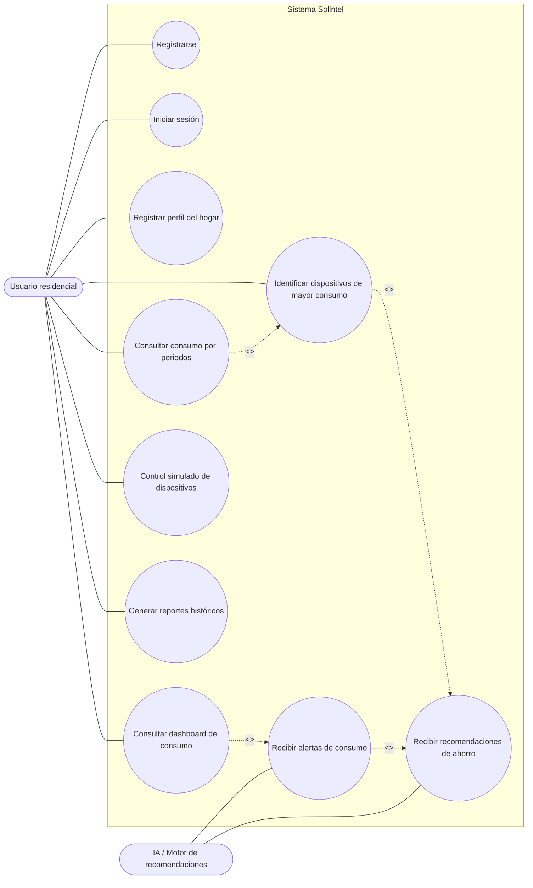
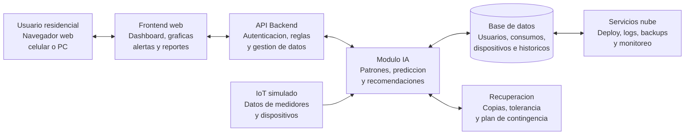
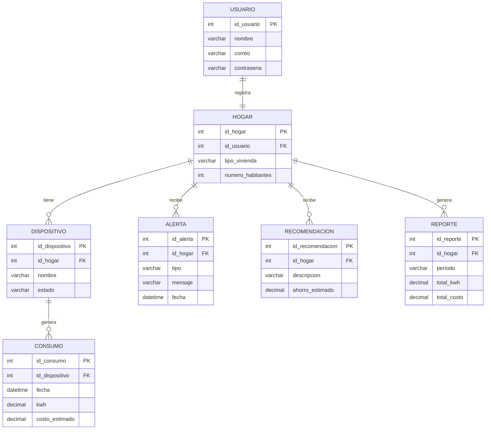

# Sollntel

**Plataforma móvil para optimizar el consumo de energía en residencias implementando IA para recomendaciones**

Universidad Manuela Beltrán
Facultad de Ingeniería, Programa de Ingeniería de Software
Asignatura: Diseño de Interfaces
Docente: Jamilton Fernando Benavides
Año: 2026

**Integrantes**

- David Santiago Cárdenas Perilla — davidcardenas.sp@academia.umb.edu.co
- Juan Pablo Rojas Fernández — pablorojas.jf@academia.umb.edu.co
- Sebastian Perez Triana — sebastianperez.t@academia.umb.edu.co

---

## 1. Levantamiento de información: necesidad y problemática

### 1.1 Población objetivo

La población objetivo de este proyecto estar conformada exclusivamente por usuarios residenciales, que habitan en apartamentos, casas y viviendas familiares que tenga la intención de gestionar de manera más eficiente su consumo en el hogar.

El perfil de los usuarios serán personas entre 20 y 60 años donde no será relevante su género y deberán contar con habilidades tecnológicas medias-básicas que usen frecuentemente dispositivos móviles y computadores con acceso a internet. Se valorarán las guías visuales, recomendaciones y las herramientas fáciles de usar.

Para un análisis inicial se tendrá en cuenta una población de 400 usuarios residenciales ubicados en Bogotá, Colombia con acceso a internet y dispositivos de consumo frecuente en el hogar. Se solicita trabajar con el 10% de la población total lo que significa que se elegirán 40 usuarios residenciales a los que por medio de encuestas y pruebas de usabilidad se les pedirá participar en el levantamiento de la información y definición de requerimientos.

**Tabla 5: Criterio y Descripción de la Población**

| Criterio | Descripción |
|---|---|
| Población total estimada | 400 usuarios residenciales |
| Muestra mínima | 40 usuarios residenciales |
| Edad aproximada | 20 a 60 años |
| Nivel tecnológico | Básico a medio |
| Intereses | Ahorro, sostenibilidad, comodidad, control del hogar |
| Problemas principales | Facturas elevadas, poca claridad del consumo, falta de alertas |
| Necesidades | Dashboard simple, recomendaciones con IA, alertas y control remoto básico |

*Autor 5: Propio*

### 1.2 Análisis de las gráficas a partir de las encuestas realizadas

**Figura 1: Aumento del valor de energía**
Pregunta 1. ¿Considera que el valor de su factura de energía ha aumentado en los últimos meses? (42 respuestas)

| Escala | 1 | 2 | 3 | 4 | 5 |
|---|---|---|---|---|---|
| Respuestas | 2 (4.8%) | 3 (7.1%) | 11 (26.2%) | 16 (38.1%) | 10 (23.8%) |

*Autor 6: Propio*

Análisis: Teniendo en cuenta la pregunta hacia los encuestados podemos evidenciar que perciben un aumento en el valor de su factura de energía ya que como se ve en la grafica las respuestas estuvieron concentradas en la mitad derecha del gráfico ósea en la escala donde se evidencia aumento de la factura. Esto es fundamental ya que se evidencia que si existe una problemática con el tema del consumo de energía en los hogares de Bogotá lo que a su vez justifica la necesidad de una plataforma para el monitoreo y análisis del consumo de energía en hogares residenciales.

**Figura 2: Claridad en consumo de energía**
Pregunta 3. ¿Tiene claridad sobre cuánta energía consume en su hogar? (42 respuestas)

| Escala | 1 | 2 | 3 | 4 | 5 |
|---|---|---|---|---|---|
| Respuestas | 7 (16.7%) | 8 (19%) | 10 (23.8%) | 12 (28.6%) | 5 (11.9%) |

*Autor 7: Propio*

Análisis: En este grafico podemos evidenciar que las respuestas están distribuidas en todo el grafico pero en la opción 4 se presentan un mayor aumento de personas que eligieron esa opción haciendo referencia que tienen claridad sobre su consumo de energía pero no obstante entre 14 y 16 personas marcaron las opciones 1 y 2 dando entender que no tienen ninguna claridad sobre el consumo de energía en sus hogares, una conclusión general seria que muchos usuarios tienen claro su consumo de energía pero no obstante una parte importante de usuarios no tiene claridad sobre sus consumos o no comprenden de donde sal el consumo de energía que se muestra en la factura.

**Figura 3: Estado de dispositivos**
Pregunta 7. ¿En su vivienda quedan dispositivos conectados o encendidos sin necesidad? (42 respuestas)

| Escala | 1 | 2 | 3 | 4 | 5 |
|---|---|---|---|---|---|
| Respuestas | 5 (11.9%) | 10 (23.8%) | 10 (23.8%) | 9 (21.4%) | 8 (19%) |

*Autor 8: Propio*

Análisis: Al igual que en el grafico de la pregunta 3 las respuestas están distribuidas en todas las opciones de respuesta del gráfico, esto quiere decir que de las personas encuestas muchas de estas tienen claro que en su vivienda quedan dispositivos electrónicos conectados que generan gastos de energía innecesarios. La escala 2 y 3 tienen la misma cantidad de respuestas con 10 respuestas en cada una mientras que 17 personas marcaron las opciones 4 y 5 lo cual demuestra que este habito de dejar dispositivos consumiendo luz son ninguna necesidad es frecuente en los hogares. Estos resultados muestran que es viable y necesario las alertar y recomendaciones de IA basados en sus datos de energía para que las personas opten por buenos hábitos energéticos y ahorrar energía.

**Figura 4: Conocer consumo de energía**
Pregunta 10. ¿Le gustaría conocer su consumo de energía por día, semana o mes? (42 respuestas)

| Escala | 1 | 2 | 3 | 4 | 5 |
|---|---|---|---|---|---|
| Respuestas | 0 (0%) | 0 (0%) | 11 (26.2%) | 15 (35.7%) | 16 (38.1%) |

*Autor 9: Propio*

Análisis: Como se ve de forma clara en la grafica los usuarios quieren conocer con más detalles su consumo de energía en diferentes lapsos de tiempo ya que la opción 4 tuvo 15 respuestas y la opción 5 tuvo 16 respuestas lo que significa que aproximadamente el 74% de los encuestados demuestran interés en saber cómo se su consumo energético lo cual es importante en el proyecto para incluir las consultas de consumos en diferentes lapsos de tiempo por medio de análisis fáciles de entender.

### 1.3 Problema que atiende

El problema principal es la poca claridad que tienen los usuarios residenciales sobre su factura de energía. Aunque la factura de energía muestra el valor que se debe pagar y el consumo del ultimo mes, no es clara en el consumo de otros lapsos de tiempo como cuanta energía se consumió en un día, semanas o semestre, no muestra horarios de mayor consumo o que dispositivos generan el mayor gasto enérgico con frecuencia. La falta de esta información no beneficia al usuario residencial y no lo alerta para tomar decisiones a tiempo y no generar costos elevados en un futuro.

**Tabla 6: Problemáticas**

| Problema observado | Impacto en el usuario | Respuesta del producto |
|---|---|---|
| Facturas elevadas sin explicacion sencilla | Dudas sobre el origen del costo y baja capacidad de control | Dashboard con consumo por periodo, dispositivo y alerta de picos |
| Desconocimiento de dispositivos de mayor gasto | Uso ineficiente de electrodomesticos de alto consumo | Ranking de dispositivos y recomendaciones por categoria |
| Falta de alertas preventivas | El usuario no corrige sus habitos a tiempo | Sistema de alertas por consumo diario, nocturno o mensual |
| Datos tecnicos dificiles de interpretar | Baja comprension del consumo energetico | Graficas simples, colores de estado y lenguaje cotidiano |
| Baja cultura de ahorro energetico | Habitos poco sostenibles en el hogar | Recomendaciones de IA segun patrones simulados |

*Autor 11: Propio*

---

## 2. Descripción del proyecto

### 2.1 Introducción

Muchos usuarios residenciales cuentan con aumentos constantes en sus facturas de energía lo cual afecta su economía e impulsa a la implementación de tácticas que sean sostenibles para disminuir estas alzas de precio. Este proyecto está orientado exclusivamente a usuarios residenciales como hogares, apartamentos y vivienda familiares en los cuales estas personas buscan entender de qué modo están utilizando su energía y como podrían mejorar su consumo teniendo en cuenta los dispositivos con mayor consumo en sus residencias. Estos usuarios deberán contar con habilidades tecnológicas básicas, interés en reducir el precio de su factura de energía y recibirán sugerencias claras para poder mejorar su consumo energético adoptando hábitos sostenibles.

Se evidencio una problemática la cual consiste en que bastantes hogares no cuentan con tecnologías y herramientas básicas para visualizar su consumo de energía en diferentes lapsos de tiempo como diaria, semanal o mensualmente, adicional a lo ya mencionado también reciben costos elevados en sus facturas de energía sin motivos claros lo cual genera dudas y no identifican con claridad que dispositivos del hogar generan más gasto. Debido a esto se desarrollará una plataforma web implementando la inteligencia artificial, IoT y datos de medidores inteligentes. Esto recopilara varias variables estadísticas y se podrán mostrar alertas preventivas a los usuarios sobre su consumo y se les hará recomendaciones para ayudar al ahorro de energía.

Hemos identificado los siguiente antecedes que refuerzan nuestro proyecto: Park, S (2023) planteo que los hogares que cuentan con sistemas inteligentes pueden implementar sensores IoT, analizar diversos datos de los sensores y modelos de aprendizaje de IA para predecir consumos mediante análisis de datos. Chen Z, Amani A, YU X y Jalili M (2023) informan que datos de medidores inteligentes ayudan a analizar patrones de consumo para optimizar la gestión energética y tomar hábitos mas eficientes. Ou Ali, Oussaid M, Maaroufi O y Kotb H K (2024) muestran que modelos de aprendizaje profundo como CNN-LSTM pueden dar un pronostico preciso del consumo energético en una vivienda inteligente. Alayed, W., Akhtar, A., Hassan, W. U. y Zeeshan, A. (2025) evidencian que las redes neuronales profundas apoyan al control de la calefacción y refrigeración para mermar el desperdicio energético sin afectar la experiencia de usuario. Mohamed, A., Ismail, I. y AlDaraawi, M. (2025) propone integrar medidores inteligentes combinando redes neuronales en aplicaciones de monitoreo inteligente para adaptar recomendaciones de energía en el hogar

La planeación de este proyecto será en apoyo del diagrama de Gantt definido en 8 semanas el cual organiza las diferentes fases a trabajar tales como análisis, investigación de necesidades de usuarios residenciales, definir la arquitectura de la plataforma y la información, diseñar la plataforma web, desarrollar un prototipo, implementar las alertas y sugerencias de la IA, realizar las pruebas de usabilidad y finalizar con la entrega del producto final. Esta planificación ayudara a establecer los tiempos de trabajo para cada parte del proyecto y dando avance con entregables que una vez unificados se lograra un prototipo funcional enfocado a los usuarios residenciales interesados en mejorar su consumo energético.

### 2.2 Objetivos

**Objetivo general**

Desarrollar una plataforma web enfocada en usuarios residenciales implementando la inteligencia artificial para monitorear, analizar y reducir el consumo energético de los hogares mediante un tablero visualizando datos, sugerencias de consumo y control básico de dispositivos inteligentes.

**Objetivos específicos**

1. Analizar las necesidades de usuarios residenciales en el consumo energético de sus hogares, ayudando a identificar problemas en costos elevados de sus facturas de energía.
2. Diseñar una plataforma web que sea accesible, clara visualmente, que permita hacer consultas de consumos en diferentes lapsos de tiempo haciendo uso de gráficos, alertas y recomendaciones.
3. Implementar un prototipo funcional con módulos de usuario, panel interactivo, reportes históricos y control básico de dispositivos en el hogar.

### 2.3 Alcance

El alcance de este proyecto es diseñar y desarrollar el prototipo funcional de la plataforma web que tendrá como nombre Sollntel, esta plataforma estará orientada a los usuarios residenciales. La solución va a permitir que los usuarios registren sus cuentas, visualicen sus consumos energéticos en diferentes lapsos de tiempos que van desde un día hasta un año, verán graficas que mostraran los históricos del consumo de energía, recibirán alertas y recomendaciones gracias a la implementación de la inteligencia artificial.

El proyecto no va a incluir una integración real con empresas de energía, tampoco se deberá incluir una instalación física de sensores. Todo el proceso IoT puede ser simulado incluyendo datos y estadísticas de consumos, la IA solo estará enfocada en recomendaciones según los datos simulados detectando patrones de consumo y alertas.

### 2.4 Diagrama de Gantt

**Figura 5: Diagrama de GANTT, Eco Hogar Inteligente**

| Actividad / Semana | S1 | S2 | S3 | S4 | S5 | S6 | S7 | S8 |
|---|:-:|:-:|:-:|:-:|:-:|:-:|:-:|:-:|
| Definición del problema residencial | X | | | | | | | |
| Recolección de información y antecedentes | X | X | | | | | | |
| Encuestas a 10 usuarios residenciales | | X | | | | | | |
| Análisis de necesidades del usuario | | X | X | | | | | |
| Definición de objetivos y alcance | | | X | | | | | |
| Arquitectura de información residencial | | | X | X | | | | |
| Diseño de user flow residencial | | | | X | | | | |
| Wireframes de baja/media fidelidad | | | | X | X | | | |
| Diseño visual del dashboard | | | | | X | | | |
| Desarrollo del prototipo web | | | | | X | X | | |
| Implementación de alertas inteligentes | | | | | | X | X | |
| Implementación de recomendaciones con IA | | | | | | X | X | |
| Pruebas de usabilidad con usuarios | | | | | | | X | |
| Ajustes finales del prototipo | | | | | | | X | X |
| Preparación de entrega y presentación | | | | | | | | X |

Nota: las barras grises representan las semanas de ejecución de cada actividad.

*Autor 10: Propio*

### 2.5 Resumen del producto

Esta plataforma web se enfocará directamente a los usuarios residenciales que quieran monitorear, comprender y lo mas importante reducir su consumo energético en sus hogares. Este producto se fundamenta en la problemática que se identifico previamente en los apartamentos y viviendas familiares: bastantes usuarios reciben costos elevados en su factura de energía, pero la mayoría de estos usuarios desconocen el motivo del aumento de su factura de energía ya que desconocen que dispositivos tienen un mayor impacto energético, en que horarios suelen existir altos picos de consumo y que acciones pueden llevar a cabo para ahorrar energía.

Esta solución propone combinar diferentes herramientas como un panel de control, visualización de datos obtenidos, medidores inteligentes simulados que estarán conectados en puntos clave del hogar, alertas dirigidas al usuario para mejorar sus hábitos y ahorrar energía. El alcance ira hasta el desarrollo del producto al 80% y no se conectará de manera real ni física con sensores. Los sensores e integración IoT será totalmente de manera simulada mediante datos simulados.

El producto va a responder a tendencias de digitalización en el consumo residencial de energía. La Unidad de Planeación Minero-Energética (UPME) dio reportes del consumo de energía en hogares residenciales y se evidencio un aumento significativo en el gasto de energía en el primer semestre del año 2024 comparado al mismo periodo del año 2023, por otro lado, administradores del mercado energético (XM) informaron aumentos en la demanda de energía eléctrica en el año 2024. Los datos de estas entidades oficiales ayudan a sustentar la importancia de las herramientas que ayudan al control y monitoreo de energía en el hogar. (UPME,2024; XM,2025).

### 2.6 Propuesta de valor

Sollntel presenta una propuesta de valor la cual consiste en transformar datos energéticos en información visual fácil de entender por usuarios con habilidades básicas en tecnología, pero no se limita la plataforma a mostrar números en un panel si no que se lleva al siguiente nivel que son componentes claves como:

- Visualizar el consumo en diferentes lapsos de tiempo como diario, semanal, mensual y anual.
- Alertas sobre el consumo energético teniendo en cuenta limites de consumo previamente establecidos.
- Sugerir recomendaciones personalizadas para cada usuario por medio de inteligencia artificial teniendo en cuenta patrones de consumo.
- Diseño fácil de usar para usuarios con habilidades básicas en tecnología.

### 2.7 Funciones principales del producto

**Tabla 7: Funciones Principales**

| Modulo | Funcion | Resultado esperado para el usuario |
|---|---|---|
| Registro e inicio de sesión | Permite crear cuenta e ingresar con credenciales. | Acceso seguro al perfil del hogar. |
| Dashboard energetico | Muestra tarjetas, gráficas y resumen del consumo. | Comprension rápida del estado energetico. |
| Consumo por periodo | Permite consultar dia, semana, mes y ano. | Comparacion de comportamientos historicos. |
| Dispositivos | Lista equipos simulados y su aporte al consumo. | Identificacion de aparatos de mayor gasto. |
| Alertas inteligentes | Genera mensajes cuando el consumo supera umbrales. | Acción preventiva antes de que aumente la factura. |
| Recommendations IA | Sugiere acciones segun patron detectado. | Mejora de habitos de ahorro energetico. |
| Reportes historicos | Resume consumos y ahorros estimados. | Seguimiento de resultados en el tiempo. |
| Control basico simulado | Permite simular encendido/apagado de dispositivos. | Demostracion de control residencial inteligente. |

*Autor 12: Propio*

### 2.8 Usuarios interesados

Los interesados en el producto son personas entre los 20 y 60 años que vivan en apartamentos, residencias y hogares familiares en Bogotá, deben contar con acceso en internet y deben contar con dispositivos que consuman energía frecuentemente. También podrían estar interesados administradores de residencias, docentes evaluadores del prototipo y el proyecto. El principal interesado son los usuarios residenciales con habilidades tecnológicas básicas y por esto la interfaz debe ser clara, intuitiva, fácil de usar, con funciones fáciles de encontrar y graficas fácil de entender.

**Tabla 10: Interesados en el Producto**

| Interesado | Necesidad | Como responde Sollntel |
|---|---|---|
| Usuario residencial | Entender y reducir el valor de la factura. | Visualización de consumo, alertas y recomendaciones. |
| Familia u hogar | Organizar habitos de uso de electrodomesticos. | Reportes por dispositivo y sugerencias de ahorro. |
| Administrador de vivienda | Promover ahorro en zonas comunes o usuarios. | Indicadores comparativos y recomendaciones generales. |
| Equipo desarrollador | Validar un prototipo funcional de interfaz. | Arquitectura clara, datos simulados y pruebas de usabilidad. |
| Docente/evaluador | Comprobar analisis, diseno y desarrollo. | Documento, maquetas, tablas, evidencias y plan de pruebas. |

*Autor 16: Propio*

### 2.9 Diagrama UML de casos de uso

**Figura 7: Diagrama UML de casos de uso del sistema**



*Autor 17: Propio*

### 2.10 Requisitos y requerimientos del usuario

Los requisitos son los encargados de describir las funcionalidades y características que los usuarios necesitan para usar la aplicación de manera eficiente. En el proyecto iniciamos con una población de 400 personas en total la cual es la población objetivo en Bogotá, pero se tomó una muestra del 10% que corresponde a 40 personas. Gracias a las encuestas realizadas se pudo levantar la información correspondiente para los requisitos y requerimientos.

#### 2.10.1 Requerimientos funcionales

**Tabla 11: Requerimiento Funcional RF01**

| Campo | Descripción |
|---|---|
| Identificación del requerimiento | RF01 |
| Nombre del requerimiento | Registro de usuarios |
| Características | Los usuarios residenciales deberán registrarse en el sistema para acceder a las funciones principales de la plataforma Sollntel. |
| Descripción del requerimiento | El sistema permitirá que el usuario cree una cuenta suministrando datos básicos como nombre, correo electrónico, contraseña, tipo de vivienda y número de habitantes del hogar. Esta información permitirá personalizar el análisis del consumo energético. |
| Requerimiento NO funcional | RNF01 - Usabilidad, RNF05 - Portabilidad, RNF06 - Seguridad, RNF07 - Accesibilidad |
| Prioridad del requerimiento | Alta |

*Autor 18: Propio*

**Tabla 12: Requerimiento Funcional RF02**

| Campo | Descripción |
|---|---|
| Identificación del requerimiento | RF02 |
| Nombre del requerimiento | Inicio de sesión |
| Características | Los usuarios registrados deberán iniciar sesión para acceder de forma segura al dashboard de la plataforma. |
| Descripción del requerimiento | El sistema permitirá validar las credenciales del usuario mediante correo electrónico y contraseña. Si los datos ingresados son correctos, el usuario podrá acceder al panel principal. En caso contrario, el sistema mostrará un mensaje de error indicando que los datos son incorrectos. |
| Requerimiento NO funcional | RNF01 - Usabilidad, RNF03 - Confiabilidad, RNF06 - Seguridad, RNF07 - Accesibilidad |
| Prioridad del requerimiento | Alta |

*Autor 19: Propio*

**Tabla 13: Requerimiento Funcional RF03**

| Campo | Descripción |
|---|---|
| Identificación del requerimiento | RF03 |
| Nombre del requerimiento | Registro del perfil del hogar |
| Características | El usuario deberá ingresar información básica de su vivienda para que el sistema pueda realizar un análisis más adecuado del consumo energético. |
| Descripción del requerimiento | El sistema permitirá registrar datos del hogar como tipo de vivienda, cantidad de personas que habitan en ella y dispositivos o electrodomésticos de uso frecuente. Esta información será utilizada para apoyar la simulación del consumo energético y las recomendaciones de ahorro. |
| Requerimiento NO funcional | RNF01 - Usabilidad, RNF03 - Confiabilidad, RNF04 - Mantenibilidad, RNF08 - Escalabilidad |
| Prioridad del requerimiento | Media |

*Autor 20: Propio*

**Tabla 14: Requerimiento Funcional RF04**

| Campo | Descripción |
|---|---|
| Identificación del requerimiento | RF04 |
| Nombre del requerimiento | Dashboard principal |
| Características | El sistema deberá mostrar al usuario un panel principal con el resumen del consumo energético del hogar. |
| Descripción del requerimiento | El sistema mostrará en el dashboard información como consumo total, costo estimado, ahorro posible, dispositivo con mayor consumo, alertas principales y recomendaciones generales. Esta pantalla permitirá al usuario identificar rápidamente el estado energético de su vivienda. |
| Requerimiento NO funcional | RNF01 - Usabilidad, RNF02 - Eficiencia, RNF07 - Accesibilidad, RNF10 - Claridad visual |
| Prioridad del requerimiento | Alta |

*Autor 21: Propio*

**Tabla 15: Requerimiento Funcional RF05**

| Campo | Descripción |
|---|---|
| Identificación del requerimiento | RF05 |
| Nombre del requerimiento | Consulta de consumo por periodos |
| Características | El usuario deberá consultar su consumo energético en diferentes rangos de tiempo. |
| Descripción del requerimiento | El sistema permitirá filtrar y visualizar el consumo de energía por día, semana, mes o año. Esta función facilitará la comparación entre periodos y ayudará al usuario a identificar aumentos o disminuciones en el consumo energético. |
| Requerimiento NO funcional | RNF01 - Usabilidad, RNF02 - Eficiencia, RNF03 - Confiabilidad, RNF10 - Claridad visual |
| Prioridad del requerimiento | Alta |

*Autor 22: Propio*

**Tabla 16: Requerimiento Funcional RF06**

| Campo | Descripción |
|---|---|
| Identificación del requerimiento | RF06 |
| Nombre del requerimiento | Visualización de gráficas de consumo |
| Características | El sistema deberá representar la información energética mediante gráficas fáciles de interpretar. |
| Descripción del requerimiento | El sistema presentará gráficas de barras, líneas o tarjetas visuales que permitan observar el comportamiento del consumo energético. Estas gráficas mostrarán comparaciones por fechas, dispositivos o periodos seleccionados por el usuario. |
| Requerimiento NO funcional | RNF01 - Usabilidad, RNF02 - Eficiencia, RNF07 - Accesibilidad, RNF10 - Claridad visual |
| Prioridad del requerimiento | Alta |

*Autor 23: Propio*

**Tabla 17: Requerimiento Funcional RF07**

| Campo | Descripción |
|---|---|
| Identificación del requerimiento | RF07 |
| Nombre del requerimiento | Visualización de dispositivos del hogar |
| Características | El usuario deberá visualizar los dispositivos o electrodomésticos que generan consumo energético en el hogar. |
| Descripción del requerimiento | El sistema mostrará una lista de dispositivos del hogar junto con su consumo aproximado, porcentaje de participación y estado simulado. Esta información permitirá identificar cuáles equipos generan mayor gasto energético. |
| Requerimiento NO funcional | RNF01 - Usabilidad, RNF03 - Confiabilidad, RNF07 - Accesibilidad, RNF10 - Claridad visual |
| Prioridad del requerimiento | Alta |

*Autor 24: Propio*

**Tabla 18: Requerimiento Funcional RF08**

| Campo | Descripción |
|---|---|
| Identificación del requerimiento | RF08 |
| Nombre del requerimiento | Generación de alertas inteligentes |
| Características | El sistema deberá emitir alertas cuando se detecte un consumo energético elevado o inusual. |
| Descripción del requerimiento | El sistema analizará los datos de consumo simulados y generará alertas cuando el consumo supere los límites establecidos. Las alertas informarán al usuario sobre posibles excesos, dispositivos críticos o hábitos que pueden aumentar el valor de la factura. |
| Requerimiento NO funcional | RNF01 - Usabilidad, RNF03 - Confiabilidad, RNF07 - Accesibilidad, RNF10 - Claridad visual |
| Prioridad del requerimiento | Alta |

*Autor 25: Propio*

**Tabla 19: Requerimiento Funcional RF09**

| Campo | Descripción |
|---|---|
| Identificación del requerimiento | RF09 |
| Nombre del requerimiento | Recomendaciones con inteligencia artificial |
| Características | El sistema deberá entregar recomendaciones personalizadas para reducir el consumo de energía. |
| Descripción del requerimiento | El sistema utilizará patrones de consumo simulados para generar recomendaciones de ahorro energético. Estas recomendaciones estarán orientadas a mejorar los hábitos del usuario, reducir el uso innecesario de dispositivos y disminuir el costo de la factura de energía. |
| Requerimiento NO funcional | RNF01 - Usabilidad, RNF03 - Confiabilidad, RNF04 - Mantenibilidad, RNF08 - Escalabilidad |
| Prioridad del requerimiento | Alta |

*Autor 26: Propio*

**Tabla 20: Requerimiento Funcional RF10**

| Campo | Descripción |
|---|---|
| Identificación del requerimiento | RF10 |
| Nombre del requerimiento | Reportes históricos de consumo |
| Características | El usuario deberá consultar reportes históricos sobre el consumo energético de su hogar. |
| Descripción del requerimiento | El sistema permitirá visualizar registros anteriores de consumo energético, organizados por fechas y periodos. Esta función permitirá comparar consumos pasados, identificar tendencias y observar si las recomendaciones aplicadas generan ahorro. |
| Requerimiento NO funcional | RNF01 - Usabilidad, RNF02 - Eficiencia, RNF04 - Mantenibilidad, RNF10 - Claridad visual |
| Prioridad del requerimiento | Media |

*Autor 27: Propio*

**Tabla 21: Requerimiento Funcional RF11**

| Campo | Descripción |
|---|---|
| Identificación del requerimiento | RF11 |
| Nombre del requerimiento | Control simulado de dispositivos |
| Características | El sistema deberá permitir activar o desactivar dispositivos inteligentes de manera simulada. |
| Descripción del requerimiento | El sistema permitirá que el usuario cambie el estado de algunos dispositivos del hogar, como encendido o apagado, dentro del prototipo. Esta función será simulada y no estará conectada a sensores o dispositivos reales. |
| Requerimiento NO funcional | RNF01 - Usabilidad, RNF03 - Confiabilidad, RNF05 - Portabilidad, RNF08 - Escalabilidad |
| Prioridad del requerimiento | Media |

*Autor 28: Propio*

**Tabla 22: Requerimiento Funcional RF12**

| Campo | Descripción |
|---|---|
| Identificación del requerimiento | RF12 |
| Nombre del requerimiento | Exportación de reporte |
| Características | El sistema deberá permitir generar un resumen básico del consumo energético del hogar. |
| Descripción del requerimiento | El sistema permitirá al usuario generar o descargar un reporte básico con información del consumo energético, alertas, recomendaciones y datos principales del hogar. Este reporte podrá usarse como evidencia o consulta posterior. |
| Requerimiento NO funcional | RNF01 - Usabilidad, RNF02 - Eficiencia, RNF04 - Mantenibilidad, RNF05 - Portabilidad |
| Prioridad del requerimiento | Baja |

*Autor 29: Propio*

#### 2.10.2 Requerimientos no funcionales

**Tabla 23: Requerimiento No Funcional RNF01**

| Campo | Descripción |
|---|---|
| Identificación del requerimiento | RNF01 |
| Nombre del requerimiento | Usabilidad |
| Características | La plataforma deberá ser fácil de usar para usuarios residenciales con conocimientos tecnológicos básicos o medios. |
| Descripción del requerimiento | La interfaz deberá presentar menús, botones, textos y gráficas de forma clara para que el usuario pueda navegar sin dificultad. El sistema deberá permitir que el usuario realice tareas básicas como registrarse, iniciar sesión, consultar el dashboard y revisar recomendaciones sin requerir ayuda externa. |
| Requerimiento relacionado | RF01, RF02, RF04, RF05, RF06, RF08, RF09 |
| Prioridad del requerimiento | Alta |

*Autor 30: Propio*

**Tabla 24: Requerimiento No Funcional RNF02**

| Campo | Descripción |
|---|---|
| Identificación del requerimiento | RNF02 |
| Nombre del requerimiento | Eficiencia |
| Características | El sistema deberá cargar las pantallas principales en un tiempo adecuado durante la ejecución del prototipo. |
| Descripción del requerimiento | Las pantallas principales de la plataforma deberán visualizarse de forma rápida, evitando tiempos de espera prolongados. El dashboard, las gráficas y los reportes deberán mostrarse en un tiempo aproximado menor o igual a 3 segundos en entorno de prueba. |
| Requerimiento relacionado | RF04, RF05, RF06, RF10, RF12 |
| Prioridad del requerimiento | Media |

*Autor 31: Propio*

**Tabla 25: Requerimiento No Funcional RNF03**

| Campo | Descripción |
|---|---|
| Identificación del requerimiento | RNF03 |
| Nombre del requerimiento | Confiabilidad |
| Características | El sistema deberá funcionar correctamente ante datos incompletos, incorrectos o simulados. |
| Descripción del requerimiento | La plataforma deberá mostrar mensajes claros cuando exista información incompleta o errores en los datos ingresados. El sistema no deberá cerrarse ni bloquearse de forma inesperada ante entradas inválidas del usuario. |
| Requerimiento relacionado | RF02, RF03, RF05, RF07, RF08, RF09, RF11 |
| Prioridad del requerimiento | Alta |

*Autor 32: Propio*

**Tabla 26: Requerimiento No Funcional RNF04**

| Campo | Descripción |
|---|---|
| Identificación del requerimiento | RNF04 |
| Nombre del requerimiento | Mantenibilidad |
| Características | El prototipo deberá tener una estructura organizada que permita realizar modificaciones o mejoras futuras. |
| Descripción del requerimiento | El código o diseño del prototipo deberá estar separado por módulos o secciones, diferenciando la interfaz gráfica, los datos simulados, las recomendaciones y las alertas. Esto facilitará futuras actualizaciones del sistema. |
| Requerimiento relacionado | RF03, RF09, RF10, RF12 |
| Prioridad del requerimiento | Media |

*Autor 33: Propio*

**Tabla 27: Requerimiento No Funcional RNF05**

| Campo | Descripción |
|---|---|
| Identificación del requerimiento | RNF05 |
| Nombre del requerimiento | Portabilidad |
| Características | La plataforma deberá poder visualizarse correctamente en diferentes dispositivos. |
| Descripción del requerimiento | El prototipo deberá adaptarse a pantallas de computador y dispositivos móviles, manteniendo una correcta visualización de textos, botones, gráficas y menús principales. |
| Requerimiento relacionado | RF01, RF11, RF12 |
| Prioridad del requerimiento | Alta |

*Autor 34: Propio*

**Tabla 28: Requerimiento No Funcional RNF06**

| Campo | Descripción |
|---|---|
| Identificación del requerimiento | RNF06 |
| Nombre del requerimiento | Seguridad |
| Características | El sistema deberá proteger el acceso a la información del usuario mediante autenticación. |
| Descripción del requerimiento | La plataforma deberá permitir el acceso al dashboard únicamente a usuarios registrados que ingresen credenciales válidas. La información del usuario no deberá estar disponible sin iniciar sesión. |
| Requerimiento relacionado | RF01, RF02 |
| Prioridad del requerimiento | Alta |

*Autor 35: Propio*

**Tabla 29: Requerimiento No Funcional RNF07**

| Campo | Descripción |
|---|---|
| Identificación del requerimiento | RNF07 |
| Nombre del requerimiento | Accesibilidad |
| Características | La interfaz deberá facilitar la lectura y comprensión de la información presentada. |
| Descripción del requerimiento | El sistema deberá utilizar contraste adecuado entre fondo y texto, tamaños de letra legibles, botones visibles e iconos claros. Esto permitirá que los usuarios comprendan fácilmente las funciones principales de la plataforma. |
| Requerimiento relacionado | RF01, RF02, RF04, RF06, RF07, RF08 |
| Prioridad del requerimiento | Alta |

*Autor 36: Propio*

**Tabla 30: Requerimiento No Funcional RNF08**

| Campo | Descripción |
|---|---|
| Identificación del requerimiento | RNF08 |
| Nombre del requerimiento | Escalabilidad |
| Características | El diseño del sistema deberá permitir futuras integraciones con datos reales o medidores inteligentes. |
| Descripción del requerimiento | Aunque el prototipo trabaja con datos simulados, su estructura deberá permitir que en futuras versiones se puedan integrar medidores inteligentes, sensores IoT o servicios externos de consumo energético. |
| Requerimiento relacionado | RF03, RF09, RF11 |
| Prioridad del requerimiento | Media |

*Autor 37: Propio*

**Tabla 31: Requerimiento No Funcional RNF09**

| Campo | Descripción |
|---|---|
| Identificación del requerimiento | RNF09 |
| Nombre del requerimiento | Disponibilidad |
| Características | El prototipo deberá estar disponible para su revisión durante la presentación y evaluación académica. |
| Descripción del requerimiento | La plataforma deberá poder abrirse correctamente desde el enlace o archivo entregado. El prototipo debe permitir la navegación por sus pantallas principales durante la revisión del docente o de los usuarios participantes. |
| Requerimiento relacionado | RF04, RF05, RF06, RF10 |
| Prioridad del requerimiento | Media |

*Autor 38: Propio*

**Tabla 32: Requerimiento No Funcional RNF10**

| Campo | Descripción |
|---|---|
| Identificación del requerimiento | RNF10 |
| Nombre del requerimiento | Claridad visual |
| Características | La información del consumo energético deberá presentarse de manera ordenada y comprensible. |
| Descripción del requerimiento | El sistema deberá organizar la información mediante tarjetas, gráficas, colores, alertas e indicadores visuales que permitan al usuario identificar rápidamente el consumo actual, los dispositivos críticos y las recomendaciones de ahorro. |
| Requerimiento relacionado | RF04, RF05, RF06, RF07, RF08, RF10 |
| Prioridad del requerimiento | Alta |

*Autor 39: Propio*

### 2.11 Restricciones del prototipo

- No se realizará una implementación real con hogares residenciales.
- No se llevará a cabo la instalación física de sensores inteligentes reales.
- Los datos serán 100% simulados para las gráficas y recomendaciones con fines académicos.
- El módulo de IA será simulado con recomendaciones de igual manera simuladas, no se usará un modelo entrenado.
- Al no contar con sensores reales los dispositivos serán una simulación visual en el tablero.
- No se contará con base de datos.
- La muestra del 10% se usó para levantar la información del proyecto, no para análisis estadísticos de la ciudad ni sobre su consumo energético.

### 2.12 Estudio de mercado

El proyecto tiene como consumidor objetivo a una persona o familiar que habita en un apartamento, casa o hogar, usa varios dispositivos electrónicos en su hogar, utiliza internet de forma constante y esta dispuesto a cambiar sus hábitos energéticos para ahorrar energia. Este proyecto está enfocado a personas entre 20 y 60 años con habilidades básicas en tecnología. Se evidencio una necesidad del mercado que consiste en aumentos de costos en las facturas de la luz de usuarios residenciales en Bogotá, también se evidencio interés por cambiar hábitos en el consumo de energia, pero no se cuenta con herramientas que sean simples de usar para que los usuarios interpreten sus datos energéticos. Este proyecto es viable ya que se respalda en el acceso a internet que tienen los hogares. Según cifras de la Encuesta Nacional de Vida de 2024, el 66% de los hogares en Colombia cuentan con acceso a internet mientras que en Bogotá en ese mismo periodo era del 82.7% lo que convierte a Bogotá en un entorno para ejecutar este proyecto enfocado a usuarios residenciales. Analizando desde el punto de vista energético, el usuario residencial necesita soluciones en la gestión y eficiencia energética. La UPME indicio aumentos del consumo energético en el sector residencial en el primer semestre del 2024 comparado al mismo periodo en 2023 y XM dio reportes que informaron sobre un evidente crecimiento de la demanda de energía en el país en 2024. Todos estos datos de entidades oficiales respaldan esta investigación sobre una herramienta para ahorrar energia y llevar el control energético del hogar.

**Tabla 35: Variables del consumidor**

| Variable del consumidor | Descripcion del mercado objetivo | Implicacion para Sollntel |
|---|---|---|
| Ubicacion | Bogotá, Colombia, con alto acceso urbano a internet. | El prototipo web puede ser probado con usuarios conectados. |
| Edad | 20 a 60 anos. | Diseno claro, no infantil, pero fácil de usar. |
| Nivel tecnologico | Basico a medio. | Navegación simple, botones visibles y textos explicativos. |
| Motivacion | Reducir factura y entender consumo. | Dashboard y recomendaciones accionables. |
| Dolor principal | No saber que dispositivo genera mayor gasto. | Ranking de dispositivos y alertas por patron. |
| Canal preferido | Celular y computador con navegador. | Web responsiva y prototipo accesible. |

*Autor 43: Propio*

La competencia no está limitada a aplicaciones exactamente idénticas. Existen aplicaciones sustitutas directas e indirectas como aplicaciones de empresas del sector energético, Domotica presentan soluciones para controlar dispositivos y hojas de cálculo manuales. La principal ventaja que presenta Sollntel está en la capacidad visual de unir los datos y mostrar gráficas, alertas y recomendaciones por IA y en su usabilidad.

**Tabla 36: Competencia y Oferta**

| Competidor o sustituto | Oferta actual | Fortalezas | Debilidades frente a Sollntel |
|---|---|---|---|
| Aplicaciones de facturación de energia | Consulta de factura, pagos y datos generales. | Canal oficial y datos reales. | Poca personalizacion y bajo enfoque en recomendaciones. |
| Soluciones de domotica IoT | Control de luces, enchufes y sensores inteligentes. | Automatizacion real del hogar. | Requieren dispositivos fisicos y mayor costo inicial. |
| Hojas de calculo manuales | Registro manual de consumos y gastos. | Bajo costo y flexibilidad. | No generan alertas ni analisis inteligente. |
| Consultorias de ahorro energetico | Diagnostico tecnico personalizado. | Analisis experto. | Costo alto y no siempre continuo. |
| Apps internacionales de Smart home | Monitoreo integrado con ecosistemas especificos. | Buena interfaz e integracion. | Pueden no adaptarse al contexto colombiano o a datos simulados locales. |

*Autor 44: Propio*

**Figura 9: Mapa de posicionamiento competitivo**

| Competidor | Nivel de personalizacion de recomendaciones | Claridad visual para usuario residencial |
|---|:-:|:-:|
| Sollntel | 8.5 | 8.5 |
| Domotica IoT | 6 | 6 |
| Apps factura | 3 | 5 |
| Consultoria energia | 7 | 4 |
| Excel/manual | 2 | 3 |

*Autor 45: Propio*

#### 2.12.1 Análisis de oportunidad

Sollntel se puede encontrar como una solución intermedia entre aplicaciones similares que presentan facturas simples y sistemas avanzados como de Domotica. La oportunidad se encuentra principalmente en ofrecer valor sin la necesidad de requerir una arquitectura física como sensores ya que el usuarios puede hacer pruebas simuladas para entender el producto y analizar sus beneficios antes de hacer una inversión monetaria con sensores reales.

**Tabla 37: Factores**

| Factor | Oportunidad | Riesgo | Respuesta estrategica |
|---|---|---|---|
| Digitalizacion de hogares | Mayor acceso a internet en Bogotá. | Usuarios con baja alfabetización digital. | Interfaz simple y pruebas de usabilidad. |
| Aumento de consumo | Interes por reducir costos. | El ahorro puede depender de habitos reales. | Recomendaciones concretas y medibles. |
| IA aplicada al hogar | Interes por soluciones inteligentes. | Desconfianza o expectativas exageradas. | Explicar que la IA recomienda, no garantiza ahorro inmediato. |
| Medicion avanzada AMI | Marco de modernización energética en Colombia. | Integración real puede ser compleja. | Prototipo preparado para datos externos en fases futuras. |
| Competencia de domotica | Mercado reconoce hogares inteligentes. | Dispositivos fisicos costosos. | Iniciar con software y simulación de bajo costo. |

*Autor 46: Propio*

#### 2.12.2 Proyecto

Sollntel se plantea comercialmente como un producto digital educativo enfocado a residencias. En su etapa académica el objetivo principal es validar correctamente funcionamiento del prototipo y verificar la aceptación y deseabilidad de los usuarios. En una futura etapa se podría llegar a ofrecer planes de monitoreo gratuitos que sean básicos para realizar pruebas y finalmente se podría llegar a ofrecer planes por pago con tablas de reportes avanzados los cuales ya necesitarían integración de sensores reales.

**Tabla 38: Elementos Comerciales**

| Elemento comercial | Propuesta |
|---|---|
| Producto | Plataforma web de gestion energetica residencial con dashboard, alertas, reportes y recomendaciones IA. |
| Precio | Modelo freemium: plan basico gratuito, plan hogar con reportes avanzados y plan conjunto residencial. |
| Plaza / canal | Sitio web, redes sociales, alianzas con conjuntos residenciales, ferias universitarias y comunidades de sostenibilidad. |
| Promocion | Campanas con mensajes de ahorro, videos demostrativos, pruebas gratuitas y casos simulados. |
| Personas | Usuarios residenciales, familias, administradores y aliados educativos. |
| Proceso | Registro, carga o simulacion de datos, visualizacion, alerta, recomendacion y seguimiento. |
| Evidencia fisica/digital | Dashboard, reportes descargables, mockups, guias de uso y resultados de pruebas. |

*Autor 47: Propio*

**Tabla 39: Estrategia de precio sugerida**

| Plan | Precio sugerido | Incluye | Publico |
|---|---|---|---|
| Basico | Gratis | Dashboard simple, datos simulados, 3 dispositivos y alertas basicas. | Usuarios que desean probar. |
| Hogar | COP $9.900 - $14.900/mes | Dispositivos ilimitados, reportes mensuales y recomendaciones avanzadas. | Familias interesadas en ahorro. |
| Conjunto residencial | COP $120.000/mes desde | Panel agregado, reportes y capacitacion de usuarios. | Administradores y comunidades. |
| Academico | Sin costo para pruebas | Prototipo, documentacion y datos simulados. | Docentes y estudiantes. |

*Autor 48: Propio*

#### 2.12.3 Canales y estrategias de lanzamiento

- Lanzamiento del prototipo en su etapa educativa para validar su funcionamiento y tener retroalimentación.
- Pruebas piloto de usabilidad con usuarios interesados en el producto
- Marketing en redes sociales del producto con mensajes de ahorro en energía en hogares y mostrar su facilidad de uso.
- Futuras alianzas con conjuntos residenciales o empresas interesadas en el producto.
- Incorporar datos reales de manera progresiva cuando se integren sensores reales.

**Tabla 40: Indicadores comerciales y comercialización**

| Indicador | Meta inicial | Forma de medicion |
|---|---|---|
| Interes de uso | 60% o más de usuarios responde que usaría la plataforma. | Encuesta. |
| Comprension del dashboard | 80% completa la tarea sin ayuda. | Prueba de usabilidad. |
| Aceptacion de alertas | 70% o más considera útiles las alertas. | Encuesta y entrevista. |
| Aceptacion de recomendaciones IA | 65% o más considera útiles las sugerencias. | Encuesta. |
| Tiempo de tarea | Consulta de consumo en menos de 1 minuto. | Observacion de prueba. |
| Intencion de pago | 20% o más pagaria por funciones avanzadas. | Pregunta de validacion comercial. |

*Autor 49: Propio*

Estos indicadores son indispensables ya que permiten evaluar si esta propuesta no solo es bien vista y funciona técnicamente si no que vas más allá y resulta deseable y viable para los usuarios.

### 2.13 Pitch - Video

Enlace del video: https://youtu.be/krD45FqX9rA

### 2.14 Conclusiones

Este proyecto responde a una necesidad previamente identificada en los usuarios residenciales que quieren comprender los aumentos sin explicación de su factura de energía y que quieren optar por buenos hábitos de consumo energético. Inicialmente este prototipo tiene un enfoque académico que ayudara a validar la interfaz y todas sus funcionalidades sin la necesidad de tener que integrar sensores físicos. Se destaca y tiene valor esta propuesta ya que no se centra en recopilar datos y mostrarlos al usuario, sino que va más allá y muestra alertas y recomendaciones según patrones de consumo.

---

## 3. Estructura del prototipo

### 3.1 Sistema utilizado

Se dar desarrollo de este proyecto de Sollntel, se propuso usar un sistema distribuido cliente/servidor que este basado en servicios web, como el público objetivo serán usuarios que vivan en apartamentos, casas y hogares residenciales estos podrán acceder de forma fácil con acceso a internet y desde un navegador web o un teléfono inteligente a consultar la información de sus consumos energéticos y ver tablas y estadísticas. Se opto por este modelo ya que permite de manera eficiente separar lo que viene siendo la interfaz del usuario, la lógica con la que funcionara el sistema y los datos almacenados, y esto es importante ya que ayuda y facilita el mantenimiento del sistema haciendo que sea a su vez escalable y permita en un futuro la integración de sensores reales.

El sistema contara con un cliente web, el servidor de la aplicación, la base de datos, módulo de IA para alertas y recomendaciones. El apartado de cliente web hace referencia a toda la parte visible para el usuario como las pantallas de registro, inicio de sesión, dashboard, graficas, alertas y recomendaciones por IA, por otro lado, el servidor es el que se encarga de procesamiento de todas las solicitudes que haga el usuario, validar la información de inicio de sesión, consultar la base de datos para mostrar los datos al usuario y coordinar demás funcionalidades del sistema.

**Tabla 1: Modelo de Distribución del Sistema**

| Capa | Componente | Función principal |
|---|---|---|
| Capa de presentación | Interfaz web / prototipo | Permite la interacción del usuario con el sistema mediante pantallas, formularios, gráficas y botones. |
| Capa de lógica de negocio | Servidor de aplicación | Procesa solicitudes, valida datos, calcula consumos, genera alertas y entrega recomendaciones. |
| Capa de datos | Base de datos | Almacena usuarios, perfiles del hogar, dispositivos, consumos simulados, alertas y reportes. |

*Autor 1: Propio*

**Tabla 2: Procesos Principales del Sistema**

| Proceso | Descripción |
|---|---|
| Registro de usuario | El usuario crea una cuenta ingresando sus datos básicos y credenciales de acceso. |
| Inicio de sesión | El sistema valida el correo y contraseña para permitir el acceso al dashboard. |
| Registro del hogar | El usuario ingresa información sobre su vivienda, número de habitantes y dispositivos principales. |
| Consulta de consumo | El usuario visualiza el consumo energético simulado por día, semana, mes o año. |
| Generación de gráficas | El sistema procesa los datos de consumo y los representa visualmente. |
| Identificación de dispositivos críticos | El sistema determina cuáles dispositivos tienen mayor participación en el consumo total. |
| Generación de alertas | El sistema compara el consumo con valores establecidos y muestra alertas cuando detecta consumo alto. |
| Recomendaciones con IA | El sistema analiza patrones de consumo y entrega sugerencias para reducir el gasto energético. |
| Reportes históricos | El usuario consulta información de consumos anteriores para comparar resultados. |
| Control simulado de dispositivos | El usuario puede activar o desactivar dispositivos dentro del prototipo de manera simulada. |

*Autor 2: Propio*

### 3.2 Sincronización del sistema

La sincronización se manejará por medio de actualizaciones de los datos entre el modelo cliente/servidor. Siempre que los usuarios realicen alguna acción como puede ser: consultar su consumo de energía, cambiar el lapso de la gráfica, añadir un nuevo dispositivo al dashboard o generar reportes, el sistema se encargará de enviar la solicitud correspondiente al servidor y este procesará la solicitud y devolverá una respuesta actualizada hacia la interfaz.

En este prototipo el apartado de sincronización será de manera simulada ya que el proyecto no contara con sensores ni medidores reales, pero no obstante el diseño va a permitir que en un futuro se pueda integrar tecnología IoT y medidores inteligentes que ayudaran a actualizar el consumo en tiempo real.

**Tabla 3: Ejemplo de Sincronización**

| Evento | Sincronización esperada |
|---|---|
| Usuario inicia sesión | Se cargan los datos asociados a su cuenta. |
| Usuario cambia el periodo de consulta | Se actualizan las gráficas y valores del dashboard. |
| Se registra un nuevo dispositivo | Se actualiza la lista de dispositivos del hogar. |
| Se detecta consumo elevado | Se genera una alerta en el panel del usuario. |
| Se genera una recomendación | Se actualiza el módulo de recomendaciones. |

*Autor 3: Propio*

### 3.3 Transacciones del sistema

En el sistema se generarán transacciones que se relacionan con el intercambio del procesamiento y del almacenamiento de la información. Estas transacciones van a permitir que se mantenga el flujo correcto de los datos entre todos los módulos del sistema.

**Tabla 4: Transacciones**

| Transacción | Descripción | Resultado esperado |
|---|---|---|
| Crear cuenta | El usuario envía sus datos de registro al sistema. | Cuenta creada y almacenada correctamente. |
| Validar acceso | El usuario ingresa correo y contraseña. | Acceso permitido o mensaje de error. |
| Guardar perfil del hogar | El usuario registra datos de su vivienda. | Perfil almacenado en la base de datos. |
| Consultar consumo | El usuario selecciona un periodo de tiempo. | El sistema muestra datos y gráficas actualizadas. |
| Generar alerta | El sistema detecta consumo superior al límite definido. | Se muestra una advertencia al usuario. |
| Generar recomendación | El sistema analiza el patrón de consumo. | Se entrega una sugerencia de ahorro energético. |
| Actualizar estado de dispositivo | El usuario activa o desactiva un dispositivo simulado. | El estado del dispositivo cambia en la interfaz. |
| Generar reporte | El usuario solicita un resumen del consumo. | Se crea un reporte visual o descargable. |

*Autor 4: Propio*

### 3.4 Modelo cliente/servidor

Se propone un modelo cliente/servidor. El cliente hace referencia a la plataforma web que utilizara el usuario residencial mediante un celular inteligente o un computador con acceso a internet. El servidor será el encargado de concentrar todo lo que viene siendo la lógica del negocio, la autenticación de los usuarios, los diferentes dispositivos conectados al panel, los datos simulados, recomendaciones y alertas inteligentes y ayudara a la preparación de la interfaz para que en un futuro sea un sistema mas robusto que pueda integrar medidores reales.

### 3.5 Arquitectura, nube y tolerancia

La arquitectura de este prototipo estará enfocada en la posibilidad de escalar. Para el desarrollo local se puede ejecutar el backend, frontend y una base de datos en equipos propios. Para un futuro despliegue, el apartado de frontend se podrá alojar en un servicio web mientras que por otro lado el backend se podrá alojar en un servidor Cloud. Para el apartado de tolerancia se propone la creación de copias de seguridad entre 1 y 2 semanas, control de los diferentes errores del sistema, registrar logs y la validación de credenciales de ingreso.

**Figura 6: Arquitectura propuesta del Prototipo**



*Autor 14: Propio*

**Tabla 9: Arquitectura**

| Aspecto tecnico | Decision propuesta | Justificacion |
|---|---|---|
| Cluster normal de desarrollo | Frontend, backend y base de datos en entorno local o academico. | Permite avanzar sin costo y facilita pruebas rapidas. |
| Cluster remoto o nube | Servicios separados para frontend, API y base de datos. | Mejora disponibilidad y simula un entorno real de produccion. |
| Tolerancia a fallos | Manejo de errores, logs y mensajes de contingencia. | Evita perdida de informacion y mejora la experiencia del usuario. |
| Recuperacion | Backups periodicos y restauracion de base de datos. | Permite recuperar consumos historicos en caso de falla. |
| Administracion | Panel para usuarios, dispositivos y parametros de alerta. | Facilita el mantenimiento y ajustes del prototipo. |

*Autor 15: Propio*

### 3.6 Frontend

#### 3.6.1 Interfaz gráfica y maquetación

La interfaz gráfica del prototipo se diseña con un enfoque claro y de sostenibilidad. El usuario al ver la interfaz deberá poder preguntarse a si mismo porque consume de más, que días consume más energía en el hogar, que acciones puedo tomar a cabo para ahorrar energía. Por esto el prototipo va a tener un apartado de graficas de consumo, alertas y recomendaciones por medio de IA teniendo en cuenta los datos previamente obtenidos.

El imagotipo integra la forma de un sol con tecnología inteligente. La palabra Sollntel se construyó teniendo en cuenta las palabras sol e inteligente. Los colores son acordes a la problemática que queremos tratar el cual es energía, sostenibilidad y ahorro de energía.

**Tabla 33: Paleta de Color y Tipografía**

| Elemento visual | Color utilizado | Código HEX | Uso dentro del prototipo |
|---|---|---|---|
| Verde azulado | Verde tecnológico | #147A84 | Botones, iconos, tarjetas informativas, gráficas y elementos de acción positiva |
| Amarillo energía | Amarillo energético | #FFD166 | Icono del sol, elementos relacionados con energía, ahorro y llamados visuales |
| Rojo alerta | Rojo / rosado de alerta | #EF476F | Alertas de consumo alto, barras críticas en gráficas y mensajes de advertencia |
| Blanco | Blanco | #FFFFFF | Fondo de tarjetas, paneles de información y zonas de lectura |
| Gris claro | Gris muy claro | #F6F8FB | Fondo general del dashboard y separación visual entre secciones |
| Gris de texto secundario | Gris medio | #6B7280 | Subtítulos, textos descriptivos y datos complementarios |
| Negro / gris oscuro | Gris oscuro | #111827 | Texto principal, títulos secundarios y contenido de alta importancia |

*Autor 40: Propio*

**Tabla 34: Distribución de Pantallas**

| Pantalla | Componentes principales | Objetivo de la pantalla |
|---|---|---|
| Inicio de sesión | Logo de Sellante, campo de correo, campo de contraseña, botón de ingresar y enlace de registro | Permitir que el usuario acceda de forma rápida y sencilla a la plataforma |
| Registro de usuario / hogar | Datos personales básicos, tipo de vivienda, cantidad de personas en el hogar y dispositivos principales | Recolectar información inicial para personalizar el análisis de consumo |
| Dashboard principal | Menú lateral, tarjetas de consumo, costo estimado, ahorro posible, dispositivo crítico, gráfica semanal y alertas | Mostrar un resumen general del estado energético del hogar |
| Consumo histórico | Filtros por periodo, gráfica comparativa, tabla de datos y resumen de consumo | Permitir que el usuario analice tendencias de consumo diario, semanal, mensual o anual |
| Dispositivos | Lista de electrodomésticos, consumo aproximado, porcentaje de participación y estado simulado | Identificar qué dispositivos generan mayor consumo energético |
| Alertas | Mensajes de advertencia, consumo alto, modo espera y recomendaciones urgentes | Avisar al usuario sobre situaciones que pueden aumentar el gasto de energía |
| Recomendaciones IA | Sugerencias personalizadas, hábitos de ahorro y acciones recomendadas | Ayudar al usuario a tomar decisiones para reducir el consumo energético |
| Reportes | Resumen de consumo, historial, datos organizados y posible exportación de información | Presentar información útil para seguimiento y análisis posterior |
| Perfil | Datos del usuario, información del hogar, preferencias de alertas y configuración básica | Permitir que el usuario gestione su información y preferencias dentro de la plataforma |

*Autor 41: Propio*

#### 3.6.2 Maquetación principal

El dashboard muestra al usuario características de sus principales consumos. Muestra el consumo que lleva durante el día, el costo estimado del consumo del día, una meta mensual que ajusta el usuario para ahorrar energia y el aproximado de dinero que ahorraría. Adicional muestra una grafica del consumo semanal del usuario con alertar preventivas sobre el consumo con un botón para aplicar recomendaciones de IA en base a los consumos pasados.

**Figura 8: Pantalla Principal**

| Elemento | Contenido |
|---|---|
| Encabezado | Hola, hogar Prieto — Resumen de consumo de hoy |
| Consumo hoy | 18.4 kWh — 14% mas que ayer |
| Costo estimado | $ 8.920 — COP acumulado hoy |
| Meta mensual | 72% — 230 de 320 kWh |
| Ahorro IA | $ 28.000 — Posible este mes |
| Tendencia semanal | Gráfica de barras L, M, M, J, V, S, D — botón Ver detalle |
| Alerta preventiva | La lavadora y la iluminacion nocturna estan elevando el consumo entre 7:00 p.m. y 10:00 p.m. |
| Botón | Aplicar recomendacion IA |
| Navegación | Inicio, Consumo, Equipos, IA, Reportes |

*Autor 42: Propio*

#### 3.6.3 Desarrollo e implementación del prototipo

El prototipo debe estar como mínimo en un 80% de funcionamiento para las funciones visibles para los usuarios. Lo que significa que se debe permitir la conectividad y navegación entre las pantallas del prototipo. Todo será simulado, pero lo que se muestra al usuario debe ser lo más real y fiel a un producto final. No se exige una conexión física con ningún tipo de sensores físicos ni una integración al 100% con hogares en Bogotá.

**Tabla 41: Módulos y Estados**

| Modulo | Estado esperado | Evidencia de desarrollo |
|---|---|---|
| Autenticacion | Formulario de registro e inicio de sesion funcional. | Capturas y prueba de acceso. |
| Dashboard | Tarjetas y graficas cargando datos simulados. | Captura del panel principal. |
| Dispositivos | Lista de electrodomesticos con consumo y estado. | Tabla en interfaz. |
| Alertas | Reglas que detectan consumo alto. | Mensajes de alerta. |
| Recomendaciones IA | Motor basico de recomendaciones por patron. | Tabla de recomendacion generada. |
| Reportes | Consulta historica por periodo. | Grafica o tabla mensual. |
| Control simulado | Cambio visual de estado encendido/apagado. | Interaccion en pantalla. |

*Autor 50: Propio*

Se trabajo en base sobre un prototipo generado por medio de código el cual se cargo a figma y se trabajaron los detalles finales sobre este:

**Figuras 10 a 13: Desarrollo por Código** (`sollntel_figma_plugin/code.js`)

```javascript
// Sollntel - Prototipo residencial con IA

async function main() {
  await figma.loadFontAsync({ family: "Inter", style: "Regular" });
  await figma.loadFontAsync({ family: "Inter", style: "Bold" });

  const W = 390;
  const H = 844;
  const GAP = 90;

  const C = {
    bg: "F6FAF8",
    bg2: "EAF7F1",
    surface: "FFFFFF",
    text: "12211A",
    muted: "65756D",
    line: "DDE8E2",
    green: "21A67A",
    greenDark: "0B6B53",
    greenSoft: "DFF6EC",
    teal: "157D8E",
    tealSoft: "DDF4F7",
    yellow: "F6C343",
    yellowSoft: "FFF3CC",
    orange: "F28C28",
    red: "E84A5F",
    redSoft: "FFE4E8",
    blue: "2E6BE6",
    blueSoft: "E8F0FF",
    navy: "102A43",
    black: "000000"
  };

  const frames = {};
  const pending = [];

  function solid(hex, opacity) {
    return { type: "SOLID", color: hexToRgb(hex), opacity: opacity === undefined ? 1 : opacity };
  }

  function hexToRgb(hex) {
    const v = hex.replace("#", "");
    return {
      r: parseInt(v.slice(0, 2), 16) / 255,
      g: parseInt(v.slice(2, 4), 16) / 255,
      b: parseInt(v.slice(4, 6), 16) / 255
    };
  }

  function addFrame(key, name, index, fill) {
    const f = figma.createFrame();
    f.name = name;
    f.x = index * (W + GAP);
    f.y = 0;
    f.resize(W, H);
    f.fills = [solid(fill || C.bg)];
    f.clipsContent = true;
    figma.currentPage.appendChild(f);
    frames[key] = f;
    return f;
  }

  function addRect(parent, name, x, y, w, h, fill, radius, stroke, strokeWeight) {
    const r = figma.createRectangle();
    r.name = name || "Rect";
    r.x = x;
    r.y = y;
    r.resize(w, h);
    r.fills = fill ? [solid(fill)] : [];
    r.cornerRadius = radius || 0;
    if (stroke) {
      r.strokes = [solid(stroke)];
      r.strokeWeight = strokeWeight || 1;
    }
    parent.appendChild(r);
    return r;
  }
  // ...
}
```

*Autores 51 a 54: Propio*

A continuación de presentan las pantallas desarrolladas del prototipo y un video validando su funcionamiento y navegabilidad entre pantallas.

**Figuras 14 a 17: Pantallas del prototipo**

| Pantalla | Nombre |
|---|---|
| 00 | Inicio / Sollntel |
| 01 | Login / Registro |
| 02 | Configuracion residencial |
| 03 | Dashboard principal |
| 04 | Consumo por periodo |
| 05 | Control de dispositivos |
| 06 | Alertas inteligentes |
| 07 | Recomendaciones IA |
| 08 | Reportes historicos |
| 09 | Plan de ahorro |
| 10 | Perfil y ajustes |

*Autores 55 a 58: Propio*

Enlace del video validando su funcionamiento: https://youtu.be/0VIu6BQCV6M

Enlace del prototipo realizado en Figma: https://www.figma.com/proto/eiN2zFtF91aPLpXtVQvxiV/Prototipo-FuncionalDI?node-id=2-1500&p=f&viewport=85%2C136%2C0.4&t=jWnDN5gVZkK6CiKL1&scaling=min-zoom&content-scaling=fixed&starting-point-node-id=2%3A1500&page-id=0%3A1

### 3.7 Commits

El control de versiones del proyecto se organiza con la siguiente convención de mensajes de commit:

| Tipo | Uso |
|---|---|
| `docs` | Documentación, análisis y requerimientos |
| `design` | Wireframes, paleta de color y maquetación |
| `feat` | Nueva funcionalidad o pantalla del prototipo |
| `fix` | Corrección de errores |
| `refactor` | Reorganización del código sin cambiar su comportamiento |
| `test` | Pruebas de usabilidad y funcionales |

Formato: `tipo(módulo): descripción`

### 3.8 Base de datos

| Capa | Componente | Función principal |
|---|---|---|
| Capa de datos | Base de datos | Almacena usuarios, perfiles del hogar, dispositivos, consumos simulados, alertas y reportes. |

*Autor 1: Propio*

- No se contará con base de datos.
- Los datos serán 100% simulados para las gráficas y recomendaciones con fines académicos.

### 3.9 Modelo relacional



---

## 4. Tecnologías aplicadas en el proyecto

**Tabla 8: Modelo Cliente/Servidor**

| Capa | Responsabilidad | Tecnologia sugerida |
|---|---|---|
| Cliente web | Presentar pantallas, graficas, formularios y alertas. | HTML, CSS, JavaScript, React o framework equivalente. |
| API backend | Gestionar usuarios, consumos, dispositivos, reportes y reglas de alerta. | Node.js/Express, Python/FastAPI or Java/Spring Boot. |
| Base de datos | Guardar usuarios, hogares, dispositivos y consumos históricos. | PostgreSQL, MySQL o Firebase. |
| Modulo IA | Clasificar patrones y generar recomendaciones. | Modelo de reglas + algoritmo predictivo simple en Python. |
| Nube | Publicar prototipo, almacenar copias y controlar logs. | Render, Vercel, Railway, Firebase or AWS Educate. |

*Autor 13: Propio*

Se trabajo en base sobre un prototipo generado por medio de código el cual se cargo a figma y se trabajaron los detalles finales sobre este.

---

## 5. Referencias bibliográficas

Alayed, W., Akhtar, A., Hassan, W. U., & Zeeshan, A. (2025). Maximizing energy savings in smart homes through artificial neural network-based artificial intelligence solutions. *Clean Energy, 9*(2), 140-149. https://doi.org/10.1093/ce/zkae113

Chen, Z., Amani, A. M., Yu, X., & Jalili, M. (2023). Control and optimisation of power grids using smart meter data: A review. *Sensors, 23*(4), 2118. https://doi.org/10.3390/s23042118

Mohamed, A., Ismail, I., & AlDaraawi, M. (2025). IoT-Driven Intelligent Energy Management: Leveraging Smart Monitoring Applications and Artificial Neural Networks (ANN) for Sustainable Practices. *Computers, 14*(7), 269. https://doi.org/10.3390/computers14070269

Ou Ali, I. H., Agga, A. A., Ouassaid, M. O., Maaroufi, M., Elrashidi, A., & Kotb, H. K. (2024). Predicting short-term energy usage in a smart home using hybrid deep learning models. *Frontiers in Energy Research, 12*, 1323357. https://doi.org/10.3389/fenrg.2024.1323357

Park, S. (2023). Machine Learning-Based Cost-Effective Smart Home Data Analysis and Forecasting for Energy Saving. *Buildings, 13*(9), 2397. https://doi.org/10.3390/buildings13092397

Departamento Administrativo Nacional de Estadística. (2025). *Encuesta Nacional de Calidad de Vida, ECV 2024*. https://www.dane.gov.co/

Ministerio de Minas y Energía. (2018). *Resolucion 40072 de 2018, mecanismos para implementar la infraestructura de medición avanzada en el servicio público de energía eléctrica*. https://www.minenergia.gov.co/

XM. (2025). *En 2024 la demanda de energía en Colombia aumento 2,3% en comparación con el año anterior*. https://www.xm.com.co/

Unidad de Planeación Minero-Energética. (2024). *Proyección de la demanda de energía eléctrica y potencia máxima*. https://www1.upme.gov.co/
