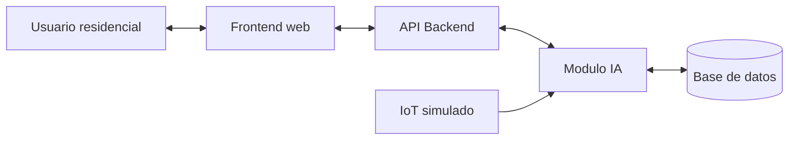
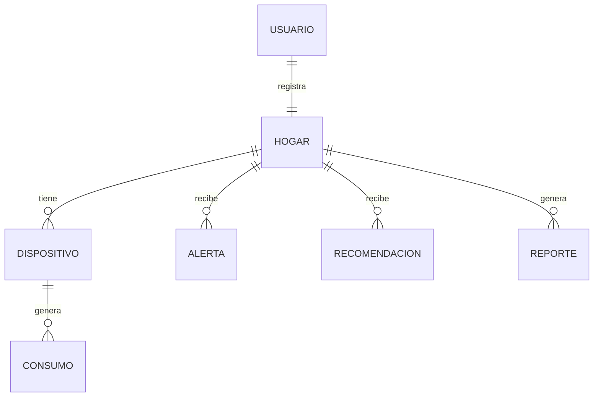

# Sollntel

**Plataforma móvil para optimizar el consumo de energía en residencias implementando IA para recomendaciones**

Universidad Manuela Beltrán
Facultad de Ingeniería, Programa de Ingeniería de Software
Asignatura: Sistemas Operativos
Docente: Jamilton Fernando Benavides
Año: 2026

**Integrantes**

- David Santiago Cárdenas Perilla — davidcardenas.sp@academia.umb.edu.co
- Juan Pablo Rojas Fernández — pablorojas.jf@academia.umb.edu.co
- Sebastian Perez Triana — sebastianperez.t@academia.umb.edu.co

---

## 1. Levantamiento de información

### 1.1 Necesidad

Para un análisis inicial se tendrá en cuenta una población de 400 usuarios residenciales ubicados en Bogotá, Colombia con acceso a internet y dispositivos de consumo frecuente en el hogar. Se solicita trabajar con el 10% de la población total lo que significa que se elegirán 40 usuarios residenciales a los que por medio de encuestas y pruebas de usabilidad se les pedirá participar en el levantamiento de la información y definición de requerimientos.

**Resultados de la encuesta (42 respuestas, escala 1 a 5)**

| Pregunta | 1 | 2 | 3 | 4 | 5 |
|---|---|---|---|---|---|
| ¿Considera que el valor de su factura de energía ha aumentado en los últimos meses? | 2 | 3 | 11 | 16 | 10 |
| ¿Tiene claridad sobre cuánta energía consume en su hogar? | 7 | 8 | 10 | 12 | 5 |
| ¿En su vivienda quedan dispositivos conectados o encendidos sin necesidad? | 5 | 10 | 10 | 9 | 8 |
| ¿Le gustaría conocer su consumo de energía por día, semana o mes? | 0 | 0 | 11 | 15 | 16 |

### 1.2 Problemática

El problema principal es la poca claridad que tienen los usuarios residenciales sobre su factura de energía. Aunque la factura de energía muestra el valor que se debe pagar y el consumo del ultimo mes, no es clara en el consumo de otros lapsos de tiempo como cuanta energía se consumió en un día, semanas o semestre, no muestra horarios de mayor consumo o que dispositivos generan el mayor gasto enérgico con frecuencia. La falta de esta información no beneficia al usuario residencial y no lo alerta para tomar decisiones a tiempo y no generar costos elevados en un futuro.

| Problema observado | Impacto en el usuario | Respuesta del producto |
|---|---|---|
| Facturas elevadas sin explicacion sencilla | Dudas sobre el origen del costo y baja capacidad de control | Dashboard con consumo por periodo, dispositivo y alerta de picos |
| Desconocimiento de dispositivos de mayor gasto | Uso ineficiente de electrodomesticos de alto consumo | Ranking de dispositivos y recomendaciones por categoria |
| Falta de alertas preventivas | El usuario no corrige sus habitos a tiempo | Sistema de alertas por consumo diario, nocturno o mensual |
| Datos tecnicos dificiles de interpretar | Baja comprension del consumo energetico | Graficas simples, colores de estado y lenguaje cotidiano |
| Baja cultura de ahorro energetico | Habitos poco sostenibles en el hogar | Recomendaciones de IA segun patrones simulados |

---

## 2. Descripción del proyecto

Desarrollar una plataforma web enfocada en usuarios residenciales implementando la inteligencia artificial para monitorear, analizar y reducir el consumo energético de los hogares mediante un tablero visualizando datos, sugerencias de consumo y control básico de dispositivos inteligentes.

El proyecto no va a incluir una integración real con empresas de energía, tampoco se deberá incluir una instalación física de sensores. Todo el proceso IoT puede ser simulado incluyendo datos y estadísticas de consumos, la IA solo estará enfocada en recomendaciones según los datos simulados detectando patrones de consumo y alertas.

| Modulo | Funcion |
|---|---|
| Registro e inicio de sesión | Permite crear cuenta e ingresar con credenciales. |
| Dashboard energetico | Muestra tarjetas, gráficas y resumen del consumo. |
| Consumo por periodo | Permite consultar dia, semana, mes y ano. |
| Dispositivos | Lista equipos simulados y su aporte al consumo. |
| Alertas inteligentes | Genera mensajes cuando el consumo supera umbrales. |
| Recommendations IA | Sugiere acciones segun patron detectado. |
| Reportes historicos | Resume consumos y ahorros estimados. |
| Control basico simulado | Permite simular encendido/apagado de dispositivos. |

---

## 3. Estructura del prototipo

### 3.1 Arquitectura

| Capa | Componente | Función principal |
|---|---|---|
| Capa de presentación | Interfaz web / prototipo | Permite la interacción del usuario con el sistema mediante pantallas, formularios, gráficas y botones. |
| Capa de lógica de negocio | Servidor de aplicación | Procesa solicitudes, valida datos, calcula consumos, genera alertas y entrega recomendaciones. |
| Capa de datos | Base de datos | Almacena usuarios, perfiles del hogar, dispositivos, consumos simulados, alertas y reportes. |

### 3.2 Frontend

Se trabajo en base sobre un prototipo generado por medio de código el cual se cargo a figma y se trabajaron los detalles finales sobre este.

Pantallas: 00 Inicio, 01 Login / Registro, 02 Configuracion residencial, 03 Dashboard principal, 04 Consumo por periodo, 05 Control de dispositivos, 06 Alertas inteligentes, 07 Recomendaciones IA, 08 Reportes historicos, 09 Plan de ahorro, 10 Perfil y ajustes.

Prototipo en Figma: https://www.figma.com/proto/eiN2zFtF91aPLpXtVQvxiV/Prototipo-FuncionalDI?node-id=2-1500&p=f&viewport=85%2C136%2C0.4&t=jWnDN5gVZkK6CiKL1&scaling=min-zoom&content-scaling=fixed&starting-point-node-id=2%3A1500&page-id=0%3A1

### 3.3 Commits

Formato: `tipo(módulo): descripción`

| Tipo | Uso |
|---|---|
| `docs` | Documentación |
| `feat` | Nueva funcionalidad o pantalla |
| `fix` | Corrección de errores |

### 3.4 Base de datos

No se contará con base de datos. Los datos serán 100% simulados para las gráficas y recomendaciones con fines académicos.

### 3.5 Modelo relacional

---

## 4. Tecnologías

| Capa | Tecnologia sugerida |
|---|---|
| Cliente web | HTML, CSS, JavaScript, React o framework equivalente. |
| API backend | Node.js/Express, Python/FastAPI or Java/Spring Boot. |
| Base de datos | PostgreSQL, MySQL o Firebase. |
| Modulo IA | Modelo de reglas + algoritmo predictivo simple en Python. |
| Nube | Render, Vercel, Railway, Firebase or AWS Educate. |
