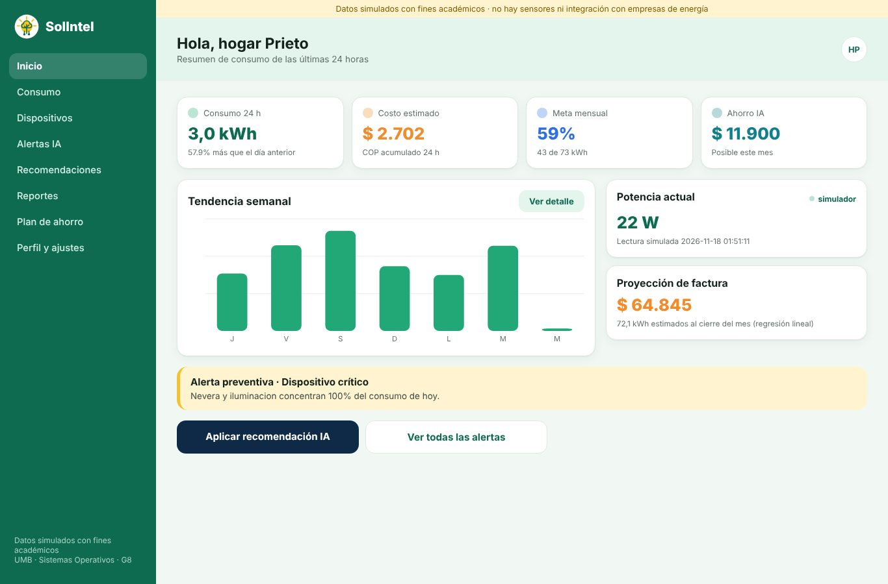
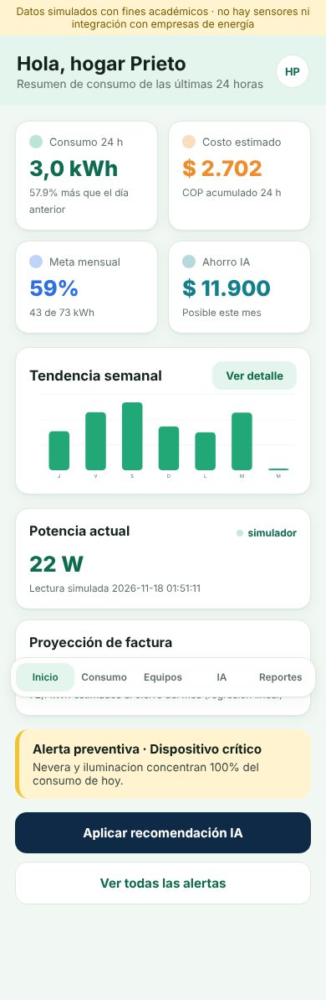

 SolIntel

Plataforma web para optimizar el consumo de energía en residencias, con recomendaciones de inteligencia artificial sobre datos simulados
Universidad Manuela Beltrán
Facultad de Ingeniería, Programa de Ingeniería de Software  
Asignatura: Sistemas Operativos  
Docente: Jamilton Fernando Benavides  

Integrantes:
- David Santiago Cárdenas Perilla —davidcardenas.sp@academia.umb.edu.co
- Juan Pablo Rojas Fernández — pablorojas.jf@academia.umb.edu.co
- Sebastian Perez Triana — sebastianperez.t@academia.umb.edu.co

Repositorio público en GitHub: https://github.com/Jpesjp/SolIntel_SistemasOperativos_G8

> **Entrega final (Guía 5 – Opción A: Repositorio).** Ver la sección [Entrega final](#entrega-final-solución-implementada): solución, instalación, pruebas, evidencias y resultados. Documento técnico completo: [`docs/documento_tecnico.md`](docs/documento_tecnico.md).
>
> **Inicio rápido:** `python src/backend/servidor.py --con-simulador` → abrir http://localhost:8080 → cuenta demo `demo@solintel.co` / `Solintel2026`.

---

## 1. Levantamiento de información

### 1.1 Necesidad
Para el análisis inicial se tuvo en cuenta una población de referencia de 400 usuarios residenciales ubicados en Bogotá, Colombia, con acceso a internet y dispositivos de consumo frecuente en el hogar. Se definió trabajar con el 10% de la población (40 usuarios) para el levantamiento de información y la definición de requerimientos mediante encuestas y pruebas de usabilidad. La encuesta fue respondida por 42 personas.

**Resultados de la encuesta (42 respuestas, escala de 1 a 5)**

| Pregunta | 1 | 2 | 3 | 4 | 5 |
| :--- | :---: | :---: | :---: | :---: | :---: |
| ¿Considera que el valor de su factura de energía ha aumentado en los últimos meses? | 2 | 3 | 11 | 16 | 10 |
| ¿Tiene claridad sobre cuánta energía consume en su hogar? | 7 | 8 | 10 | 12 | 5 |
| ¿En su vivienda quedan dispositivos conectados o encendidos sin necesidad? | 5 | 10 | 10 | 9 | 8 |
| ¿Le gustaría conocer su consumo de energía por día, semana o mes? | 0 | 0 | 11 | 15 | 16 |

### 1.2 Problemática
El problema principal es la poca claridad que tienen los usuarios residenciales sobre su factura de energía. Aunque la factura muestra el valor a pagar y el consumo del último mes, no detalla cuánta energía se consumió en un día, una semana o un semestre, ni muestra los horarios de mayor consumo ni qué dispositivos generan el mayor gasto con frecuencia. Esta falta de información impide que el usuario tome decisiones a tiempo y evite costos elevados en el futuro.

| Problema observado | Impacto en el usuario | Respuesta del producto |
| :--- | :--- | :--- |
| Facturas elevadas sin explicación sencilla | Dudas sobre el origen del costo y baja capacidad de control | Dashboard con consumo por periodo, dispositivo y alerta de picos |
| Desconocimiento de los dispositivos de mayor gasto | Uso ineficiente de electrodomésticos de alto consumo | Ranking de dispositivos y recomendaciones por categoría |
| Falta de alertas preventivas | El usuario no corrige sus hábitos a tiempo | Sistema de alertas por consumo diario, nocturno o mensual |
| Datos técnicos difíciles de interpretar | Baja comprensión del consumo energético | Gráficas simples, colores de estado y lenguaje cotidiano |
| Baja cultura de ahorro energético | Hábitos poco sostenibles en el hogar | Recomendaciones de IA según patrones simulados |

---

## 2. Descripción del proyecto

### 2.1 Descripción general
SolIntel es una plataforma web enfocada en usuarios residenciales que implementa inteligencia artificial para monitorear, analizar y reducir el consumo energético de los hogares, mediante un tablero de visualización de datos, sugerencias de ahorro y control básico de dispositivos inteligentes.

### 2.2 Carácter simulado del proyecto
SolIntel es un proyecto simulado. Por definición de la asignatura, todo el componente de medición y de dispositivos es simulado:

- Los datos de consumo, dispositivos, alertas, recomendaciones y reportes son simulados y se generan mediante un script propio de simulación.
- El componente IoT es simulado: no existe instalación física de sensores ni de medidores.
- El control de encendido y apagado de dispositivos es simulado.
- No existe integración real con empresas comercializadoras u operadoras de energía.
- La inteligencia artificial solo realiza recomendaciones, detección de patrones y alertas sobre los datos simulados, mediante un modelo de reglas y un algoritmo predictivo simple.

> ⚠️ **Aviso en la interfaz:** La aplicación mostrará de forma visible el aviso: *"Datos simulados con fines académicos"*.

| Módulo | Función |
| :--- | :--- |
| **Registro e inicio de sesión** | Permite crear cuenta e ingresar con credenciales. |
| **Dashboard energético** | Muestra tarjetas, gráficas y resumen del consumo simulado. |
| **Consumo por periodo** | Permite consultar día, semana, mes y año. |
| **Dispositivos (simulados)** | Lista equipos simulados y su aporte al consumo. |
| **Alertas inteligentes (simuladas)** | Genera mensajes cuando el consumo simulado supera umbrales. |
| **Recomendaciones IA** | Sugiere acciones según el patrón detectado en los datos simulados. |
| **Reportes históricos** | Resume consumos y ahorros estimados a partir de datos simulados. |
| **Control básico simulado** | Permite simular el encendido y apagado de dispositivos. |

### 2.3 Justificación
Los usuarios residenciales reciben una factura que informa el valor a pagar, pero no explica cuándo ni en qué dispositivos se consume más energía. Los resultados de la encuesta lo confirman: la mayoría percibe un aumento en su factura y casi todos desean conocer su consumo por día, semana o mes. SolIntel propone una solución que hace visible el consumo, alerta sobre picos y recomienda acciones de ahorro, usando datos simulados para desarrollar y validar la idea sin depender de infraestructura física. Además, el proyecto permite aplicar los conceptos de Sistemas Operativos (procesos, planificación, archivos, memoria y concurrencia) en una solución concreta.

### 2.4 Objetivos

**Objetivo general**  
Desarrollar una plataforma web simulada que permita monitorear, analizar y reducir el consumo energético residencial mediante la visualización de datos simulados y recomendaciones generadas por inteligencia artificial.

**Objetivos específicos**
1. Levantar los requerimientos de los usuarios residenciales mediante encuestas y pruebas de usabilidad.
2. Diseñar la arquitectura y la estructura del producto en tres capas: presentación, lógica de negocio y datos.
3. Diseñar en Figma las 11 pantallas de la aplicación.
4. Implementar un generador de datos simulados de consumo y un módulo de IA basado en reglas para alertas y recomendaciones.
5. Aplicar conceptos de Sistemas Operativos (procesos, planificación de tareas, sistema de archivos, memoria y concurrencia) en el desarrollo.
6. Organizar la documentación y el código en un repositorio público de GitHub con control de versiones.

### 2.5 Alcance inicial
- **Incluye:** registro e inicio de sesión, dashboard energético, consumo por periodo, dispositivos simulados, alertas inteligentes, recomendaciones de IA, reportes históricos, plan de ahorro y control básico simulado.
- **No incluye:** integración con empresas de energía, instalación física de sensores, datos reales de consumo ni aplicación móvil nativa.

### 2.6 Usuarios y beneficiarios
Usuarios residenciales de Bogotá, Colombia, con acceso a internet y dispositivos eléctricos de uso frecuente. Población de referencia: 400 usuarios; encuesta aplicada a 42 personas. Beneficiarios indirectos: el hogar completo y, a largo plazo, el uso eficiente de la energía.

### 2.7 Funcionalidades principales
- Registro e inicio de sesión de usuarios.
- Configuración residencial del hogar.
- Dashboard con consumo simulado por día, semana, mes y año.
- Ranking de dispositivos simulados de mayor consumo.
- Alertas por consumo diario, nocturno o mensual.
- Recomendaciones de ahorro generadas por IA.
- Reportes históricos y plan de ahorro.
- Control básico simulado de dispositivos.

### 2.8 Relación con los conceptos de Sistemas Operativos

| Concepto | Aplicación en SolIntel |
| :--- | :--- |
| **Procesos e hilos** | El servidor backend atiende solicitudes concurrentes y el simulador IoT se ejecuta como un proceso independiente que genera lecturas de consumo. |
| **Planificación de tareas** | Tareas programadas (cron o scheduler) generan consumos periódicos y evalúan los umbrales de alerta. |
| **Sistema de archivos** | Los datos simulados se almacenan en archivos JSON/CSV organizados por directorios, con permisos de lectura y escritura. |
| **Gestión de memoria** | Uso de caché en memoria para consultas frecuentes del dashboard. |
| **Entrada/Salida** | Lectura y escritura de los archivos de datos; los dispositivos simulados se tratan como periféricos virtuales. |
| **Concurrencia y sincronización** | Control del acceso simultáneo a los archivos de datos para evitar inconsistencias. |
| **Seguridad y usuarios** | Autenticación de usuarios y separación de los datos por hogar. |
| **Entorno de ejecución** | Desarrollo en Windows o Linux y despliegue sobre Linux, con opción de contenedores (Docker). |

---

## 3. Estructura del producto

### 3.1 Arquitectura inicial

| Capa | Componente | Función principal |
| :--- | :--- | :--- |
| **Capa de presentación** | Interfaz web | Permite la interacción del usuario mediante pantallas, formularios, gráficas y botones. |
| **Capa de lógica de negocio** | Servidor de aplicación (API backend) y módulo de IA | Procesa solicitudes, valida datos, calcula consumos, genera alertas y entrega recomendaciones. |
| **Capa de datos** | Archivos JSON/CSV con datos simulados | Almacena usuarios, perfiles del hogar, dispositivos, consumos simulados, alertas y reportes. |
| **Simulador** | Script de simulación IoT | Genera los consumos y el estado de los dispositivos simulados. |

**Flujo general:** Usuario residencial ↔ Frontend web ↔ API backend ↔ Módulo IA ↔ Archivos de datos simulados; el simulador IoT alimenta al módulo IA y a los archivos de datos.

> *(Insertar aquí el diagrama de arquitectura exportado como imagen draw.io)*

### 3.2 Componentes y módulos principales

| Componente | Descripción |
| :--- | :--- |
| **Frontend web** | Interfaz de las 11 pantallas del sistema. |
| **API backend** | Autenticación, consulta de consumos, alertas, reportes y control simulado. |
| **Módulo IA** | Reglas y algoritmo predictivo simple en Python que detecta patrones y genera recomendaciones. |
| **Simulador IoT** | Proceso independiente que genera lecturas de consumo simuladas. |
| **Almacenamiento** | Archivos JSON/CSV con los datos simulados. |

### 3.3 Diseño de la interfaz (Frontend)
Se trabajó a partir de un diseño generado mediante código, que se cargó en Figma, donde se afinaron los detalles finales.

**Pantallas:** 00 Inicio, 01 Login / Registro, 02 Configuración residencial, 03 Dashboard principal, 04 Consumo por periodo, 05 Control de dispositivos, 06 Alertas inteligentes, 07 Recomendaciones IA, 08 Reportes históricos, 09 Plan de ahorro, 10 Perfil y ajustes.

🎨 **Diseño en Figma:** [Ver Prototipo Funcional](https://www.figma.com/proto/eiN2zFtF91aPLpXtVQvxiV/Prototipo-FuncionalDI?node-id=2-1500&p=f&viewport=85%2C136%2C0.4&t=jWnDN5gVZkK6CiKL1&scaling=min-zoom&content-scaling=fixed&starting-point-node-id=2%3A1500&page-id=0%3A1)

### 3.4 Almacenamiento de datos
El proyecto no utiliza un motor de base de datos. Los datos son 100% simulados y se almacenan en archivos JSON/CSV generados por el script de simulación. El modelo relacional de la sección 3.5 representa la estructura lógica de esos datos.

### 3.5 Modelo de datos

| Entidad | Relación |
| :--- | :--- |
| **USUARIO** | Registra un HOGAR (1 a 1) |
| **HOGAR** | Tiene muchos DISPOSITIVOS (1 a N) |
| **DISPOSITIVO** | Genera muchos CONSUMOS (1 a N) |
| **HOGAR** | Recibe muchas ALERTAS (1 a N) |
| **HOGAR** | Recibe muchas RECOMENDACIONES (1 a N) |
| **HOGAR** | Genera muchos REPORTES (1 a N) |
| Directorio | Contenido |
| :--- | :--- |
| `documentacion/` | Documento técnico, requerimientos, arquitectura y diagramas. |
| `src/frontend/` | Código de la interfaz web. |
| `src/backend/` | API y lógica de negocio. |
| `src/ia/` | Módulo de reglas y recomendaciones. |
| `src/simulador/` | Script que genera los datos simulados. |
| `datos/` | Archivos JSON/CSV simulados. |
| `recursos/imagenes/` | Imágenes y capturas del proyecto. |
| `pruebas/` | Pruebas del sistema. |

### 3.7 Control de versiones: formato de commits
Formato: `tipo(módulo): descripción`

| Tipo | Uso |
| :--- | :--- |
| **docs** | Documentación |
| **feat** | Nueva funcionalidad o pantalla |
| **fix** | Corrección de errores |

**Ejemplos:**
- `docs(readme): agrega descripción y objetivos`
- `feat(simulador): genera consumos diarios simulados`

---

## 4. Tecnologías y entorno

### 4.1 Tecnologías seleccionadas

| Capa | Tecnología seleccionada |
| :--- | :--- |
| **Cliente web** | HTML, CSS, JavaScript y React o framework equivalente. |
| **API backend** | Node.js con Express (o Python con FastAPI). |
| **Almacenamiento** | Archivos JSON/CSV con datos simulados. |
| **Módulo IA** | Modelo de reglas y algoritmo predictivo simple en Python. |
| **Diseño y diagramas** | Figma y draw.io. |
| **Control de versiones** | Git y GitHub. |
| **Despliegue** | Render, Vercel o Railway. |

### 4.2 Requerimientos de hardware y software
- **Hardware mínimo (desarrollo):** procesador de 2 núcleos, 8 GB de RAM y 10 GB de disco libre.
- **Hardware mínimo (usuario):** cualquier equipo o celular con navegador moderno e internet.
- **Software:** Node.js (LTS), Python 3.10 o superior, Git, Visual Studio Code, navegador Chrome o Firefox y Figma.
- **Sistema operativo y entorno de ejecución:** Windows 10/11 o Linux (Ubuntu 22.04) para desarrollo; despliegue sobre Linux en un servicio en la nube.

---

## 5. Requerimientos

### 5.1 Requerimientos funcionales

| Código | Descripción |
| :--- | :--- |
| **RF01** | El sistema permitirá registrar usuarios e iniciar sesión. |
| **RF02** | El sistema mostrará un dashboard con el resumen del consumo simulado. |
| **RF03** | El sistema permitirá consultar el consumo por día, semana, mes y año. |
| **RF04** | El sistema listará los dispositivos simulados y su aporte al consumo. |
| **RF05** | El sistema generará alertas cuando el consumo simulado supere los umbrales definidos. |
| **RF06** | El sistema mostrará recomendaciones de IA según los patrones de los datos simulados. |
| **RF07** | El sistema generará reportes históricos y ahorros estimados. |
| **RF08** | El sistema permitirá simular el encendido y apagado de dispositivos. |

### 5.2 Requerimientos no funcionales

| Código | Categoría | Descripción |
| :--- | :--- | :--- |
| **RNF01** | Usabilidad | Lenguaje cotidiano, gráficas simples y colores de estado. |
| **RNF02** | Rendimiento | El dashboard debe cargar en menos de 3 segundos. |
| **RNF03** | Compatibilidad | Funcionamiento en los navegadores modernos. |
| **RNF04** | Seguridad | Contraseñas cifradas y sesiones autenticadas. |
| **RNF05** | Mantenibilidad | Código modular y commits con formato `tipo(módulo): descripción`. |
| **RNF06** | Transparencia | Todos los datos deben identificarse como simulados en la interfaz. |

---

## 6. Estado actual

| Fase | Estado |
| :--- | :--- |
| Fase I – Levantamiento, diseño y planeación | Completada |
| Fase II – Avance funcional (generador, analizador y dashboard estático) | Completada |
| Fase III – Entrega final (plataforma web, API, IA, servicios del SO, seguridad, pruebas y evidencias) | **Completada** |

---

## 7. Referencias

- Silberschatz, A., Galvin, P. B., & Gagne, G. (2018). *Operating System Concepts* (10.ª ed.). Wiley.
- Tanenbaum, A. S., & Bos, H. (2015). *Modern Operating Systems* (4.ª ed.). Pearson.
- ISO/IEC. (2011). *ISO/IEC 25010:2011 Systems and software engineering — Systems and software Quality Requirements and Evaluation (SQuaRE) — System and software quality models.*
- OpenJS Foundation. (s. f.). *Node.js documentation*. https://nodejs.org/docs
- Meta Platforms. (s. f.). *React documentation*. https://react.dev
- Figma. (s. f.). *Figma help center*. https://help.figma.com

## Fase II: Avance funcional (proyecto simulado)

En esta fase se implementó la solución planteada en la Fase I como un **proyecto simulado**: los datos de consumo de los dispositivos (IoT) los genera un programa, sin hardware real.

### Componentes implementados

| Componente | Archivo | Función |
|---|---|---|
| Generador de datos simulados | `src/simulador/generador_datos.py` | Simula el consumo por hora de 8 dispositivos del hogar y lo guarda en `data/consumo_simulado.csv` |
| Analizador y recomendaciones | `src/ia/analizador.py` | Calcula consumo total, promedio diario, costo estimado y consumo por dispositivo; genera recomendaciones de ahorro (motor de reglas) en `data/reporte.txt` |
| Dashboard web | `src/fase2/generar_web.py` | Genera `src/fase2/web/index.html` con indicadores, gráfico de distribución, consumo por dispositivo y por hora |

### Entorno de trabajo
- Sistema operativo: Windows 10/11
- Lenguaje: Python 3.13 (solo librerías estándar, sin dependencias externas)
- Control de versiones: Git y GitHub
- Editor: Visual Studio Code

### Estructura del repositorio
```
(En la entrega final estos archivos se reorganizaron así)
src/simulador/generador_datos.py
src/ia/analizador.py
src/fase2/generar_web.py  ->  src/fase2/web/index.html
data/consumo_simulado.csv, data/reporte.txt
evidencias/fase2/
```

### Cómo ejecutar
```
python src/simulador/generador_datos.py --dias 30 --salida data/consumo_simulado.csv
python src/ia/analizador.py
python src/fase2/generar_web.py
```
Después se abre `src/fase2/web/index.html` en el navegador.

### Pruebas de funcionamiento

| # | Prueba | Resultado esperado | Resultado obtenido | Evidencia |
|---|---|---|---|---|
| 1 | Generar 30 días de datos simulados | Se crea `data/consumo_simulado.csv` y se muestra el consumo total | Archivo generado, 77.49 kWh en 30 días | `evidencias/fase2/ejecucion_fase2.JPG` |
| 2 | Ejecutar el analizador sobre el CSV | Reporte con consumo por dispositivo y recomendaciones | Reporte con 8 dispositivos (nevera 33.4 %) y 5 recomendaciones; se guarda en `data/reporte.txt` | `evidencias/fase2/ejecucion_fase2.JPG` |
| 3 | Generar el dashboard web | Se crea `web/index.html` con gráficos | Dashboard con indicadores, gráfico circular y consumo por hora | `evidencias/fase2/dashboard_web.JPG` |
| 4 | Repetir con la misma semilla | Mismos resultados | Se obtienen los mismos valores (semilla 42) | Terminal |

### Resultados obtenidos
- Consumo total simulado: 77.49 kWh en 30 días (promedio diario 2.50 kWh).
- Costo estimado: $69,737 COP (tarifa de referencia de 900 COP/kWh).
- Dispositivo de mayor consumo: nevera (33.4 %). Hora de mayor consumo: 19:00.


### Registro de avances
El historial de commits del repositorio documenta el avance de esta fase.

---

## Entrega final: solución implementada

La versión final integra las fases anteriores (generador y analizador de la Fase II) en una **plataforma web completa** que corre como **servicio de Linux** administrado, con las **11 pantallas del prototipo en Figma**.

### Componentes

| Componente | Archivo | Función | Concepto de SO |
| :--- | :--- | :--- | :--- |
| Frontend web | `src/frontend/` | SPA responsive (HTML, CSS y JS sin dependencias) con las pantallas 00–10 | — |
| API backend | `src/backend/servidor.py` | 15 endpoints REST, archivos estáticos, monitoreo `/api/sistema` | Hilos (`ThreadingHTTPServer`), proceso hijo, señales |
| Seguridad | `src/backend/seguridad.py` | PBKDF2, sesiones con expiración, bloqueo por fuerza bruta | Seguridad y usuarios |
| Almacenamiento | `src/backend/almacen.py` | JSON/CSV por hogar, escritura atómica, permisos 600 | Sistema de archivos, exclusión mutua entre procesos (`flock`) |
| Simulador IoT | `src/simulador/simulador_iot.py` | Proceso independiente: completa el historial por hora y la lectura en vivo cada 30 s; respeta el estado de los dispositivos | Procesos, planificación, E/S, PID |
| Módulo IA | `src/ia/motor_ia.py` | Reglas (alertas y recomendaciones con ahorro en COP) y regresión lineal (proyección del mes) | Gestión de memoria (caché en RAM) |
| Servicios | `config/systemd/` | `solintel-web` y `solintel-simulador` con endurecimiento | Servicios, límites de CPU y memoria |
| Automatización | `scripts/linux/`, `scripts/windows/` | Instalar, iniciar, detener, monitorear, respaldar y probar (Bash y PowerShell) | Automatización |
| Configuración del SO | `config/cron`, `config/logrotate`, `config/firewall` | Tareas programadas, rotación de logs, UFW / Firewall de Windows | Planificación, seguridad |

### Pantallas (Figma → web)

| # | Pantalla | Ruta | Qué hace |
| :--- | :--- | :--- | :--- |
| 00 | Inicio | `#/inicio` | Presentación del producto |
| 01 | Login / Registro | `#/login`, `#/registro` | Crear cuenta e iniciar sesión (RF01) |
| 02 | Configuración residencial | `#/configuracion` | Vivienda, factura, meta de ahorro y prioridades |
| 03 | Dashboard | `#/dashboard` | Consumo 24 h, costo, meta, ahorro IA, tendencia, potencia en vivo, proyección (RF02) |
| 04 | Consumo por periodo | `#/consumo` | Día, semana, mes y año; pico, promedio, rango normal y aporte por dispositivo (RF03) |
| 05 | Control de dispositivos | `#/dispositivos` | Encender, apagar o poner en standby (simulado) (RF04, RF08) |
| 06 | Alertas inteligentes | `#/alertas` | Riesgo nocturno, dispositivo crítico, hábitos, standby, anomalías, meta (RF05) |
| 07 | Recomendaciones IA | `#/recomendaciones` | Acciones con ahorro estimado en COP/mes (RF06) |
| 08 | Reportes históricos | `#/reportes` | Mensual, trimestral y anual; exportar CSV e imprimir/PDF (RF07) |
| 09 | Plan de ahorro | `#/plan` | Meta personalizada, avance y lista de hábitos |
| 10 | Perfil y ajustes | `#/perfil` | Cuenta, cambio de clave, hogar y **estado del sistema** (PID, hilos, memoria, carga, disco, simulador) |

| Escritorio | Móvil |
| :---: | :---: |
|  |  |

### Estructura del repositorio

```
SolIntel_SistemasOperativos_G8/
├── src/
│   ├── frontend/        index.html, styles.css, app.js, logo.svg
│   ├── backend/         servidor.py, seguridad.py, almacen.py
│   ├── ia/              motor_ia.py, analizador.py (Fase II)
│   ├── simulador/       simulador_iot.py, generador_datos.py (Fase II)
│   └── fase2/           dashboard estático de la Fase II
├── config/              solintel.json, systemd/, cron/, logrotate/, firewall/
├── scripts/
│   ├── linux/           instalar.sh, iniciar.sh, detener.sh, monitorear.sh, respaldo.sh, probar.sh
│   └── windows/         iniciar.ps1, detener.ps1, monitorear.ps1, respaldo.ps1, tareas_programadas.ps1
├── tests/               test_solintel.py (21 pruebas)
├── docs/                documento_tecnico.md
├── evidencias/          instalacion/, pruebas/, seguridad/, monitoreo/, respaldos/, capturas/, fase2/
├── data/                datos simulados (los datos de usuarios se crean al ejecutar y no se versionan)
├── Dockerfile, docker-compose.yml
└── README.md
```

### Instalación y ejecución

Requisito único: **Python 3.10 o superior** (solo librería estándar, sin `pip install`).

**Opción 1 – Desarrollo (Windows, Linux o macOS)**
```bash
python src/backend/servidor.py --con-simulador
# Abrir http://localhost:8080   ·   demo@solintel.co / Solintel2026
```
En Windows también: `powershell -ExecutionPolicy Bypass -File scripts\windows\iniciar.ps1`

**Opción 2 – Servidor Linux (Ubuntu 22.04/24.04) como servicio**
```bash
sudo bash scripts/linux/instalar.sh
systemctl status solintel-web solintel-simulador
sudo ufw status verbose
```
El instalador crea el usuario de sistema `solintel` y el grupo `solintel-admin`, copia a `/opt/solintel`, aplica permisos (código 750, datos 700, usuarios 600), instala los servicios systemd, cron, logrotate y el firewall.

**Opción 3 – Docker**
```bash
docker compose up -d
```

**Operación diaria**

| Tarea | Linux | Windows |
| :--- | :--- | :--- |
| Iniciar / detener | `scripts/linux/iniciar.sh` / `detener.sh` (o `systemctl start/stop`) | `iniciar.ps1` / `detener.ps1` |
| Monitorear | `scripts/linux/monitorear.sh` | `monitorear.ps1` |
| Respaldar / restaurar | `respaldo.sh` / `respaldo.sh --restaurar <archivo>` | `respaldo.ps1` |
| Probar | `scripts/linux/probar.sh` | `python -m unittest discover -s tests -v` |
| Programar tareas | `config/cron/solintel` | `tareas_programadas.ps1` |

### Configuración del sistema operativo

| Componente | Configuración aplicada | Evidencia |
| :--- | :--- | :--- |
| Sistema operativo | Ubuntu 24.04.5 LTS (kernel 6.x), Python 3.13 | `evidencias/monitoreo/` |
| Usuarios y grupos | `solintel` (sistema, sin shell), `solintel-admin` (equipo) | `evidencias/seguridad/seguridad_linux.txt` |
| Permisos | `/opt/solintel` 750, `data` 700, `usuarios.json` 600, `logs` 2750, umask 027 | `evidencias/seguridad/seguridad_linux.txt` |
| Procesos y servicios | Servidor (PID padre) + simulador (PID hijo), systemd con reinicio automático | `evidencias/monitoreo/`, `config/systemd/` |
| Red | Puerto 8080/tcp, `/api/salud` | `evidencias/pruebas/pruebas_api.txt` |
| Almacenamiento | JSON/CSV por hogar, respaldos `tar.gz` + SHA-256, rotación de 7 | `evidencias/respaldos/respaldo_linux.txt` |
| Seguridad | UFW (22 y 8080), PBKDF2, bloqueo 429, CSP, endurecimiento systemd, auditoría | `evidencias/seguridad/seguridad_linux.txt` |
| Monitoreo | CPU, memoria, disco, procesos, puertos, salud, auditoría | `evidencias/monitoreo/` |

### Pruebas realizadas y resultados

**21 de 21 pruebas automáticas aprobadas** (`evidencias/pruebas/pruebas_unitarias.txt`).

| # | Prueba | Resultado esperado | Resultado obtenido |
| :---: | :--- | :--- | :--- |
| 1 | Registro, cuenta duplicada, login y logout | 201, 409, 200 y token inválido tras logout | Correcto |
| 2 | 15 endpoints de la API con sesión | HTTP 200 en todos | Correcto |
| 3 | Rutas protegidas sin token | HTTP 401 | Correcto |
| 4 | 6 intentos de login con clave incorrecta | 5 × 401 y luego 429 (bloqueo 5 min) | Correcto |
| 5 | Rendimiento del dashboard (RNF02) | Menos de 3 s | 0,17 s en la primera carga y 2–3 ms con caché |
| 6 | Apagar/encender un dispositivo | Estado guardado y potencia actual 0 W | Correcto |
| 7 | Simulador con dispositivo apagado / standby | 0 kWh / consumo de standby | Correcto |
| 8 | Relleno de 5 horas faltantes del historial | Agrega exactamente 5 horas | Correcto |
| 9 | 4 **procesos** incrementando un contador compartido 50 veces cada uno | 200 sin pérdidas | 200 |
| 10 | 20 **hilos** cambiando dispositivos y leyendo el dashboard a la vez | Sin errores y archivo íntegro | Correcto |
| 11 | Caché en memoria | Segunda lectura sale de la RAM | Correcto |
| 12 | Usuario ajeno lee `usuarios.json` | *Permission denied* | Correcto |
| 13 | *Path traversal* `/../../config/solintel.json` | No expone el archivo | Correcto |
| 14 | Cabeceras de seguridad | CSP, X-Frame-Options, nosniff | Correcto |
| 15 | Respaldo y verificación SHA-256 | `OK` | Correcto |
| 16 | Interfaz en escritorio (1366 px) y móvil (390 px) | 11 pantallas sin errores de consola | Correcto (`evidencias/capturas/`) |

### Resultados obtenidos

- Plataforma web funcional con las 11 pantallas, adaptable a escritorio y celular, y aviso visible de datos simulados (RNF06).
- Los 8 requerimientos funcionales (RF01–RF08) implementados.
- Hogar demo: ≈ 86 kWh proyectados para el mes (≈ COP 77.000 a 900 COP/kWh); la IA detecta riesgo nocturno (+22 % en la franja de 6 p.m. a 11 p.m.), hábitos de iluminación prolongada y riesgo de superar la meta; propone 8 acciones con ahorro estimado de ≈ COP 12.000/mes.
- Servicio con usuario sin privilegios: servidor ≈ 35 MB de RAM, simulador < 0,3 % de CPU, API entre 1 y 170 ms.

### Limitaciones

- Los datos son simulados; las cifras de ahorro son estimaciones del motor de reglas.
- Las evidencias se generaron en una VM Ubuntu 24.04 sin systemd ni UFW activos (entorno de contenedor), por eso `instalacion_linux.txt` muestra esos pasos como omitidos. En un Ubuntu Server normal el mismo script los instala; se recomienda adjuntar la salida de `systemctl status` y `ufw status verbose` de la VM del equipo.
- Sin HTTPS: para producción se recomienda un proxy inverso (Nginx + Let's Encrypt).

### Conclusiones

1. La concurrencia entre el servidor y el simulador obligó a usar exclusión mutua real entre procesos; la prueba con 4 procesos lo comprobó sin pérdida de datos.
2. Ejecutar el servicio con un usuario sin privilegios, permisos mínimos, umask y endurecimiento de systemd limita el impacto de una falla.
3. Los scripts de instalación, respaldo y monitoreo hacen el despliegue repetible y verificable en Linux y Windows.
4. Con datos simulados se validó la idea completa (visualización, alertas, predicción y recomendaciones) sin infraestructura física.

### Registro de avances

El historial de commits documenta cada fase con el formato `tipo(módulo): descripción` (`feat`, `fix`, `test`, `docs`, `refactor`).
